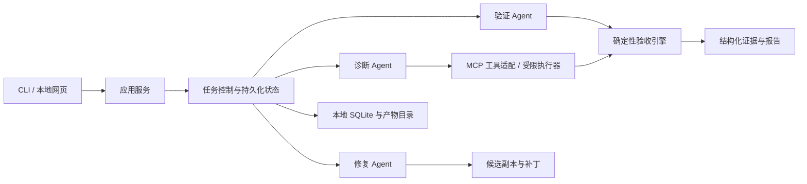

# 架构与技术决策

版本 0.1 / 2026-10-13。下图为目标边界；交付进度见台账。

## 1. 模块职责

| 模块 | 输入 / 输出 | 权限与边界 | 首次迭代 |
|---|---|---|---|
| contracts | 工具声明+调用证据 → 结构化检查结果 | 纯检查；不调用模型/工具 | P0-01 |
| CLI | 本地 JSON → stdout 报告+退出码 | 有界读取、限时子进程 | P0-01 |
| adapters | MCP 声明/响应 → 标准证据 | 官方 SDK，明确协议版本 | P0-02 |
| runner | 固定用例 → 真实执行轨迹 | 隔离、超时、取消、资源上限 | P0-03 |
| run store | 状态事件与产物摘要 → 可恢复记录 | 单本地实例；原子事务 | P0-04 |
| agent graph | 诊断→修复→独立验证 | LangGraph；条件边、有限循环 | P0-05 |
| verifier | 冻结基线+候选 → 验收与回归结论 | 不能改评分规则和固定测试 | P0-06 |
| product UI | 产品首页、任务/证据/诊断/diff/回归/记忆/接入 | UI-01 完整界面，真实功能逐项解锁 | UI-01 / P1-01 |

## 2. 技术栈与引入顺序

| 层 | 决策 | 理由 | 状态 |
|---|---|---|---|
| 核心 | Python 3.12 + uv | 统一运行环境、可复现依赖 | M0 引入 |
| 数据结构 | Pydantic v2 + JSON Schema 2020-12 + jsonschema | 输入严格验证；语义检查使用标准实现 | M0 引入 |
| CLI | 标准库 argparse / multiprocessing | 首项无需额外 CLI 框架 | M0 引入 |
| MCP | 官方 Python SDK 2.3.0 | 协议兼容交给 SDK，自研领域工具行为 | P0-02 已锁定，最终门禁见台账 |
| 执行 | subprocess/asyncio + Docker | 进程回收与隔离复制；不等于多租户安全沙箱 | M1 引入 |
| 状态 | SQLite + SQLAlchemy + Alembic | 单机事务与迁移；不堆 Redis/队列 | M1 引入 |
| 编排 | LangGraph | 状态机、中断、有限恢复 | M2 引入 |
| 模型 | 已有 DeepSeek 兼容接口+薄适配层 | 复用用户模型，凭据从环境提供 | M2 接入 |
| API | FastAPI + Uvicorn；SSE 后续按需 | UI-01 提供本地检查接口，后续扩展任务进度 | UI-01 提前引入 |
| 网页 | Next.js + TS + Tailwind；shadcn/ui + Monaco 按需 | UI-01 产品首页及完整模块预览；真实任务能力逐项接入 | UI-01 提前引入 |
| 测试 | pytest + Hypothesis + Ruff + mypy | 行为、性质、静态约束 | M0 引入 |
| 观测 | JSON 报告；后续 structlog+事件流 | 失败必须可查，默认不落原始数据 | 分期 |
| CI | GitHub Actions | 确定性门禁；模型评估单独预算 | 已随公开开发快照执行；见 UI-05 / CI-01 验收 |

依赖只在需要的任务引入；候选栈不是安装清单。暂不引入 A2A、Redis、Celery、pgvector、Kubernetes、通用调度平台。

## 3. Agent 协作与可扩展性

- 诊断角色：只读源码/证据，生成可执行假设和复现任务。没有程序验证只能返回 hypothesis / inconclusive。
- 修复角色：仅可编辑候选副本的明确文件白名单，不能编辑输入证据、固定测试和验收阈值。
- 验证角色：独立上下文，运行固定测试与额外检查；基线与候选使用同一验收器。模型解释不能覆盖程序失败。
- 控制器：负责有限状态转移、预算和权限，不用第四个模型模拟调度器。
- 新增角色需声明输入/输出 schema、权限、预算、触发条件和独立验收用例，经 ADR 批准注册；不硬编码“永远只有三个”。

同一模型的角色会有相关错误。拆角色是权限和上下文分离，提升效果必须由对照实验证明。简单契约失败直接由程序处理，不强制三角色轮转。

角色目录与维护约定见 [09 Agent 模块](09-agent-modules.md)。每个角色的代码、契约、提示词及单元测试集中于 `agents/<role>/`，公共编排和执行边界独立维护。P0-05a已落地类型契约、纯策略与只读schema目录；P0-05b 已接通模型、工具、预算与持久分析，见[运行规格](24-p0-05b-runtime.md)及[验收记录](25-p0-05b-delivery.md)。

## 4. 状态、恢复与记忆（M1/M2）

P0-04 当前执行状态：`queued → running → succeeded / failed / cancelled / outcome_unknown`。尚无审批状态；P0-05 的分析/候选结果与 P1-01 的人工审批需独立契约和迁移，不直接塞入现有枚举。终态不由过期 worker 回写覆盖。每次执行用独立 attempt_id；只有匹配当前版本和 lease 的 worker 可以 CAS 更新运行状态。业务写入与事件写入同一 SQLite 事务。

恢复时先由用户显式运行 `runs reconcile` 对账执行器与已保存产物；当前不在启动时自动对账。断连、调用超时或进程消失但远端可能执行时标 outcome_unknown，不能自动重投。未来只读操作可按显式策略有限重试；写操作要有工具提供的幂等键/结果查询。checkpoint 不自动赋予工具 exactly-once。M0 没有后台任务和持久化恢复。

| 记忆 | 内容 | 保存规则 |
|---|---|---|
| 工作上下文 | 当前证据摘要、计划、未证实假设 | 按预算裁剪，可从运行事件重建 |
| 运行记录 | 状态、工具/代码版本、调用摘要、产物哈希 | P0-04 小报告≤1MiB以SQLite BLOB与终态同事务；大文件产物后续另行设计；迁移有版本 |
| 项目经验 | 人工确认的约束、已验证修复条件 | 附来源、版本适用范围、失效条件；不把失败猜测存成事实 |

首版检索用项目/工具/版本/错误代码过滤，不用向量库。默认不存原始敏感数据；用户选择保存的证据包保持本地，支持显式删除，摘要删除不等于外部备份已删除。保留期与清理命令在 P0-04 固定。

## 5. ADR

| ID | 决策与替代方案 | 代价 / 重新评估条件 |
|---|---|---|
| ADR-001 | 聚焦工具可靠性；暂缓通用 Agent 平台 | 场景覆盖有限；完成真实接入验证后再扩 |
| ADR-002 | 先确定性契约，再有限模型修复 | M0 无自主性；为后续提供独立验证器 |
| ADR-003 | 本地单实例 SQLite；暂缓 Postgres+队列 | 多用户远端执行需要重新设计权限/调度 |
| ADR-004 | 使用官方 MCP SDK；不重写协议栈 | 依赖版本升级必须通过兼容用例 |
| ADR-005 | M0 禁止 schema 引用、正则及未知断言语义 | 安全和实现边界优先；支持集合见 05，扩展需负向测试 |
| ADR-006 | 本地 JSON 证据检查不代表真实复现 | M1 补真实协议和执行链，单独记录结果 |
| ADR-007 | 用户要求完整产品 UI 提前为 UI-01，配薄本地检查 API | UI 可先行、功能逐项解锁；预览明确标注，P1-01 接入真实运行及审批 |
| ADR-008 | P0-02 固定审核 profile，SDK 清理预算由草案 3 秒调整为 7 秒 | 依据 SDK 实际 6.5 秒清理流程；任意命令及硬隔离仍为后续工作，见 08 |
| ADR-009 | 每个产品 Agent 分目录维护，公共编排/模型/执行保持独立 | 用户要求可维护结构；只建立文档边界，不提前创建通用注册框架，见 09 |

## 6. 官方参考（设计依据）

- [jsonschema 验证](https://python-jsonschema.readthedocs.io/en/stable/validate/)：先检查 schema，再验证实例；默认 format 是注释语义。
- [jsonschema 引用](https://python-jsonschema.readthedocs.io/en/stable/referencing/)：使用显式注册表，禁止隐式网络检索。
- [LangGraph](https://docs.langchain.com/oss/python/langgraph/overview)：编排能力与持久化由框架提供，业务副作用一致性仍由应用负责。

资料内容会变化；引入时依据锁定版本 API 与测试，不照搬旧代码示例。

## ADR-010：P0-03 本地受控执行边界（2026-10-13）

背景：P0-02 已证明 MCP 握手和真实调用，宿主 stdio 进程仍缺硬资源边界。
决定：执行模块独立放 `runner/`（配置/证据、Docker 控制、字节输送、运行协调、CLI），
复用 MCP 会话和确定性检查器。`containers/p0_03/` 只承载审核过的合成故障服务，
不引入通用任务队列、数据库或新模型；产品 Agent 角色仍按 `agents/<role>/` 维护。

以唯一 run UUID/name/labels 绑定生命周期；正常取消 shield 创建 ACK、finally 有界清理并核实。
创建请求超时保留未知，即时查无容器不能证明稍后不会创建。调用发出无可靠结果也保留未知，
不提供 exactly-once 或自动重试承诺。宿主 SIGKILL 靠容器独立监护停止，停止残留只能精确显式回收。
持久状态和恢复对账留 P0-04（实际采用显式 `runs reconcile`，不自动重投）。

替代：纯宿主 subprocess 无法满足 Linux cgroup 配额；gVisor/多租户调度目前增加部署成本而无用户证据。
代价：需要本机 Docker/Colima、固定 Linux/cgroup v2 镜像；Docker 不是恶意多租户安全认证。
重新评估：开放任意用户代码、远程 daemon、多用户、持久 Web 运行时，必须先做隔离/权限/持久化设计。
实现及验收详见 [11](11-controlled-execution.md)。

## ADR-011：P0-04 小报告原子持久化与只读网页

使用已规划的SQLite/SQLAlchemy/Alembic存储状态、CAS租约和事件。当前产物仅≤1MiB的脱敏JSON报告，采用SQLite BLOB与终态同事务提交，避免外部文件与DB双写窗口；未来大文件另行设计，不以此支持任意目录产物。

任务页本阶段提前接通真实只读列表/事件/报告，满足功能进度在前端实际可见的要求。发起执行、审批与取消仍按P1-01；不新增Web副作用。报告读取与删除采用SQLite事务快照，不使用独立文件GC或增加队列。

固定短任务租约120秒、不自动重试。状态对账保留unknown，即使容器已消失也不能推断工具没有副作用。见[14](14-run-store.md)。

## ADR-012：DOC-03 受控工具与三角色测试边界

背景：进入 P0-05 前，需要明确模型角色、被测 MCP 工具和内部工具的区别，以及可执行的验收用例。

决策：内部工具先通过严格 Python 契约和宿主权限网关暴露；外部被测工具复用官方 MCP SDK，不为每个内部函数新增 MCP server。诊断/修复/验证按独立上下文与权限分离，控制器保持确定性。P0-05 只读及建议；P0-06 才注册候选应用和冻结比较工具。具体工具 T01～T08、测试 A01～A15 / R01～R11 见 [17](17-agent-tools-testing-plan.md)。

首版模型协作使用前台串行协调；不宣称跨进程恢复模型循环，不复用120秒短执行lease作为600秒Agent任务lease。Agent摘要存储/API契约在P0-05a评审。默认12次模型请求、20次受控工具请求、两候选及600秒总任务上限；token额度必须显式配置，保守预留不能证明安全时拒绝调用。

替代：全工具MCP化、四个模型相互调度、提前引入通用任务平台会扩大维护和故障面。代价：初期只适合审核过的本地项目，不能宣称任意工具接入或自主修复。重新评估条件：三个不同工具项目接入、对照收益和外部客户端复用证据；新增协议/角色另行ADR及测试。

## ADR-013：提前接入固定场景网页受控复现

依据用户对运行页操作性与复现命令的要求，将P1-01a从完整Web/审批里拆出，依赖P0-03/04。复用既有隔离执行器和SQLite，不增加通用shell/调度框架。接收请求原子入库、数据库单Web槽、持久取消与去重墓碑，配合跨进程owner存活锁阻止暂停worker穿越过期lease边界。代价是新增一次schema迁移和故障窗口验收；当前限定macOS/Linux本地可信单用户。模型闭环与候选审批继续P0-05/06及P1-01。设计/测试见[22](22-web-reproduction.md)，独立设计预审通过不等于实现完成。

### ADR-015：受约束模型协作与条件性预算上界（P0-05b）

复用 LangGraph StateGraph 串行条件边；宿主掌握权限、预算、工具生命周期和最终状态。SQLite 0003 保存安全摘要、固定枚举事件和执行关联；不持久化原始模型内容，不重放中断模型循环。每角色使用独立上下文，携带注册器核验的证据摘要，减少重复读取。

用户授权按官方模型文档配置现有网关，采用绑定模型/配置版本的条件性输入上界，每次先持久预留再发请求；缺失 usage 保留预留并停止。代价是保守预留较大，且无法独立证明网关执行上游上限。单轮输出按角色为 4096/8192/4096。替代方案是取得网关配置或可信 tokenizer 后收紧输入预留；不以字符估算冒充硬上界。

P0-05b 只输出临时片段建议，验证角色核对证据与候选元数据；不读取另一角色的成功自述，不将其当成已修复。应用/冻结回归和同预算单 Agent 对照仍由 P0-06 完成。

## P1-02 设计增量（2026-10-19，尚未实现）

长期记忆当前业务与架构依据见[44：业务、外部接入与产品交互](44-p1-02-memory-product-and-integration.md)。[42](42-p1-02-memory-research-design.md)保留早期设计，原先仅精确召回及排除Cognee的结论已被取代。

现有SQLite + SQLAlchemy + Alembic继续承担权威事实、确认/撤回与请求预留。记忆加工和检索由独立适配层接入，Cognee为优先验证对象，公开版本、后端、embedding、费用与删除契约须通过MR-01后锁定。确定性权限/来源核验与语义召回分开，同项目跨版本内容只能按策略作为历史参考，当前修复仍执行冻结回归。

统一事件接入覆盖插件Hook、测试适配器、CI/SDK及报告导入；轻量采集后持久入队，后台加工不阻塞主流程。角色与受控执行不重建，网页按接入、故障、修复、经验、对比的操作路径展开。全部新增运行能力仍未实现，工作包依赖以44与台账为准。

### ADR-017：权威记忆领域与事件账本（M1-R已实现）

[46](46-m1-r-authority-event-store.md)实现experience_memory模块与0011迁移，复用既有SQLite事务和Alembic，确认/修订/撤回与outbox原子提交；租约与实际请求预留各自持久去重，未知结果禁止重放。Cognee1.6.5与既有模型已按[45](45-mr-01-cognee-contract-validation.md)完成选型实验，生产适配由M2-R实施。当前领域接口只供可信本地宿主调用，没有外部HTTP鉴权入口或自动采集；旧ADR-016的全部未实现为当时状态。
