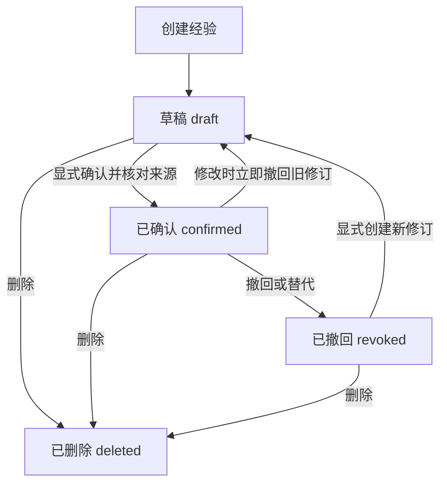

# P1-02：项目经验记忆早期调研与设计记录

日期：2026-10-19（Asia/Shanghai）。基线：B5 `67b50d0` 已推送。Feature P1。

当前状态：本页为**已被部分取代的历史设计记录**。当前业务、记忆职责、外部接入、UI和实施门禁以[44：长期记忆业务、外部接入与产品交互](44-p1-02-memory-product-and-integration.md)为准。运行时记忆仍未实现。

**阅读规则：以下第1–11节均保留当时的方案和判断，不再作为当前直接开工依据。**其中“排除Cognee”“只允许同版本精确召回”“没有后台提取/外部接入”及“M1 ready”已被44取代；CAS、撤回、删除、冻结回归隔离等不变量由44保留并重新适配。原M0评审通过不代表新业务范围已经实现或引擎选型验收通过。原文件快照哈希保留在旧评审报告，不覆盖历史结论。

## 1. 决策摘要

实现一个**经确认的项目经验库**：把可追溯的修复经验保存为独立条目，下次遇到同项目、同工具版本及同类故障时，为诊断和修复提供有限参考。每次仍重新复现、生成隔离候选并执行冻结回归。

选型：**现有 SQLite + SQLAlchemy + Alembic；自研经验生命周期、适用性判断与审计；复用现有 LangGraph、角色目录、模型网关、受控工具桥和网页审批交互。** 这是已定义的本地产品范围内的正式架构，不是等待替换的临时实现。经验库不依赖新增模型、embedding、向量库、图数据库或云记忆服务；M1–M5仅拆分交付和验收，不各自重选技术栈。

完整核心交互：

1. 修复通过后，用户在候选详情点击“保存为项目经验”，预览来源、适用范围及将提供给 Agent 的内容。
2. 显式确认后成为可检索经验；“接受候选”和“保存经验”是两个决定，不自动互相替代。
3. 下次任务在受控 T08 查询中命中适用条目，页面说明命中原因和来源；无匹配则正常执行原流程。
4. 版本变化、来源失效、撤回或过期后不再给模型使用；用户可查看原因、撤回、删除。

价值假设是减少重复探索及人工重复说明。是否提高修复率、减少调用与耗时，要通过有/无记忆的同条件实验验证；新增数据库表或一次命中不构成效果证明。

## 2. 先回答 B5 的一次“无法判定”

### 2.1 事实与影响

[41 交付记录](41-p1-01-b5-delivery.md)第二轮返回类型案例：2 次模型调用、1 次工具调用，最终 `inconclusive / INVALID_MODEL_OUTPUT`，没有形成已验证候选。四次实际修复中三次通过；样本太小且重复同两案例，不能把 75% 作为通用准确率。

这是**任务完成率问题**：用户没有拿到修复结果。当前程序按约束停止，没有把未验证输出当成成功，安全边界发挥了作用；B5 集成门禁通过不等于模型可靠性问题已经消失。

现有错误码会汇总严格解析、角色输出校验及不允许的交接等失败。未保存模型原文，因此**不能精确断言是哪一个字段、工具或交接判断错误**，也不能据后一次成功宣称根因已解决。代码依据：`repair_contracts/codec.py`、`repair_runtime/controller.py::_model/_handoff/run`、`model_gateway/gateway.py::decode_reply`。

### 2.2 处理方案与独立跟踪

后续状态更新（2026-10-19）：用户要求两项先修复，REL-01/02已按[43实施与验收](43-rel-01-02-model-recovery.md)完成。本节下表保留最初排期，现以43及其独立复审为准；本批仅保存请求摘要和阶段错误码，没有新增决策正文摘要。

| 跟踪项 | 优先级 / 责任 | 具体动作 | 验收标准 |
|---|---|---|---|
| REL-01 协议拒绝可定位 | Feature P1 / 执行链维护者；M1 前完成设计、M3 前实现 | 记录固定拒绝阶段与枚举原因，如 envelope/schema/role_transition/evidence_reference；保存 request/decision 摘要、角色、版本；不记模型原文、字段值或 Pydantic input | 确定性注入每类不合法输出；固定原因可定位、日志/API不含原值、合法用量结算且未知不退款；失败仍不可转为通过 |
| REL-02 有界格式纠正试验 | Feature P1 / 模型运行维护者；REL-01 后另行设计 | 只研究“输出已收到且用量已结算，但尚未接收任何工具动作”的协议失败；最多一次纠正调用，消耗原任务预算 | 不重放已接收工具、不重发未知模型请求、不重试错误候选以凑结果；单独报告纠正前后效果与成本 |

REL-02 已独立交付，记忆模块复用其有界协议恢复能力。若原因是缺失证据或无法完成，应正常拒判，不把这类合法拒判变成格式纠正。不能通过放宽 schema、跳过冻结测试、自动替换成更大模型或循环重跑来解决。

**记忆与这次失败的关系**：只有确认是重复知识缺失、且存在适用经验时，记忆才可能帮忙。输出格式错误需要协议诊断与纠正机制；本次无法判定记录不能自动晋升为“修复经验”，更不能从错误码推导一条确定根因。

## 3. 业界方案：借鉴哪些，为什么不直接全套接入

调研日期为本页日期，依据以下官方文档和维护者仓库。记录机制与适配判断，不使用 star 数、宣传准确率或不同基准上的成绩做选型。官方文档随时间变化；未安装、未跑第三方框架基准、未完成其供应链审计。以下“适配判断”是本项目推论。

| 方案与一手来源 | 官方机制 | 本项目采用的思想 | 本轮选择 |
|---|---|---|---|
| [LangGraph memory](https://docs.langchain.com/oss/python/concepts/memory)、[persistence](https://docs.langchain.com/oss/python/langgraph/persistence) | 区分线程状态与跨线程 Store；长期条目按 namespace/key 组织 | 工作状态与经验独立、显式作用域、有限检索 | 保留已有 LangGraph；经验库用领域服务和 SQLite，不改已有执行账本为另一套 checkpoint |
| [LangMem](https://langchain-ai.github.io/langmem/concepts/conceptual_guide/) | 记忆提取/整合与存储集成分离；支持运行中或后台形成记忆 | 形成经验与任务执行解耦 | 采用确定性草稿与人工确认，不采用后台 LLM 提取和自动 prompt 优化 |
| [Mem0 OSS](https://docs.mem0.ai/open-source/overview)、[Add Memory](https://docs.mem0.ai/core-concepts/memory-operations/add) | 可运行本地 SDK；add 支持模型提取、metadata 与实体作用域 | 独立条目、筛选字段、管理接口 | 不直接把聊天提取当成工程事实；经验管理不依赖额外 embedding/提取模型。当前 add 文档说明 ADD-only，不能沿用旧文章假设其自动覆盖/删除语义 |
| [Letta memory blocks](https://docs.letta.com/v1-sdk/memory/memory-blocks) | 结构化块常驻上下文，可共享并设只读 | 角色可见性、只读参考、上下文有界 | 不迁移到另一套 Agent runtime；不让修复角色改写自己的长期权限/规范 |
| [Graphiti](https://github.com/getzep/graphiti) | 时态关系、历史保留及混合检索；依赖图存储等组件 | 事实何时有效与何时记录分开 | 当前没有关系遍历需求；用时间/版本字段表达失效，不引入图服务 |
| [AgentCore namespaces](https://docs.aws.amazon.com/bedrock-agentcore/latest/devguide/specify-long-term-memory-organization.html)、[episodic strategy](https://docs.aws.amazon.com/bedrock-agentcore/latest/devguide/episodic-memory-strategy.html) | namespace 组织长期记忆；episode 与反思有独立形成逻辑 | 项目隔离、单次经历与泛化结论分开 | 当前本地单用户，不增加 AWS 账户、外发与云部署依赖 |

共同启发是分离记录、提取、作用域、检索与使用。**这些产品的通用记忆能力不等于本项目的代码版本适用性、冻结回归可信性和审批撤销一致性。** 后三项必须由本项目掌握。

### 3.1 正式架构决策：按完整职责选型

决策范围来自[产品约束](01-constraints.md)：本地 CLI 与网页，为 Python Agent/MCP 工具提供复现、修复、验收及项目经验复用。覆盖经验形成、管理、检索、使用、失效和审计的完整生命周期；不能把两款合成案例的验证范围当成产品目标。

| 必须满足的需求 | 确定采用的实现 | 选择依据与代价 |
|---|---|---|
| 确认、撤回、来源决定和模型请求预留保持一致 | 现有 SQLite 权威数据库，同库事务；SQLAlchemy + Alembic | 可以核对来源决定并原子绑定记忆版本与请求预留，避免另建记忆服务后出现跨库一致性缺口；写并发受 SQLite 约束，不宣称支持多租户共享服务 |
| 项目经验有来源、版本、确认和删除语义 | 自研 `experience_memory` 领域模块，五类逻辑表 | 自研业务规则，复用数据库/迁移库；不自研数据库、通用记忆平台或 Agent 框架 |
| 经验必须适用当前任务 | SQL 索引过滤 + 确定性 eligibility + 有界稳定排序 | 能解释每个命中与排除原因；不承诺同义文本召回、自动跨版本迁移或跨项目泛化 |
| 多角色使用相同可信经验，仍各自遵守权限 | 现有 LangGraph + 统一 T08 只读工具 + memory_refs | 诊断/修复读取，验证独立；不为每个 Agent 复制数据库或创建另一个记忆 Agent |
| 可检查污染、竞态和实际收益 | 生命周期/冲突/删除测试 + 同预算有无记忆对照 | 数据库写入成功与 Agent 效果改善分别验收；未测得收益不能宣传提高修复率 |

**采用**：上述整套架构。**不采用**：Cognee、Mem0、LangMem、Letta 或 Graphiti 作为项目经验权威存储/生命周期引擎；不设“完成若干批次后换成其中一个”的迁移任务。通用框架不能替本项目决定旧补丁在新版本是否有效，权限与冻结回归仍需本项目实现。

SQLite 的选择基于既定本地交付形态和同库事务要求，不只是为了少装一个服务。P2-02 的多用户服务是有独立需求前提的产品范围变更，不是 P1-02 上线必须经历的“升级数据库”步骤。范围不变时，M1–M5与P1-03接入沿用本决策；变更范围必须新建ADR，说明迁移成本与证据，不能边开发边静默换型。

namespace 只负责分组，不替代授权；成功复用次数只作统计，不自动提高可信级别。源码/契约/环境版本变化时拒绝注入；重新取得当前版本的验证与确认后形成新经验。精确匹配带来的跨版本复用限制是产品能力边界，不用未来引入向量检索的承诺掩盖。

### 3.2 Cognee 的结论

补充核验日期：2026-10-19。[官方文档](https://docs.cognee.ai/)描述了文档/对话形成可检索记忆、Python/MCP/HTTP入口及嵌入式部署；[官方 Postgres 方案](https://www.cognee.ai/graph-on-postgres)支持把图、向量与元数据放在一个 PostgreSQL 实例。因此，不以“必须部署三套数据库”作为排除依据。

本项目不选 Cognee 的原因是职责匹配：P1-02 接收有明确来源与审批的结构化工程经验，检索依据为宿主绑定的项目、版本与可见故障签名，没有文档实体抽取或图遍历需求。即使接入 Cognee，版本适用性、审批撤回、冲突和请求预留的一致性仍必须自己实现；本需求下没有证明额外抽取/检索层带来的收益。此结论是架构适配判断，未安装或压测 Cognee，不是对其质量或性能的否定。

## 4. 现有代码与新增边界

| 当前已有 | 实际位置 | P1-02 处理 |
|---|---|---|
| 运行账本、版本、模型用量 | `repair_store/`、`run_store/` | 继续保存事实，不复制成“对话记忆” |
| 严格角色契约与有限状态循环 | `agents/<role>/repair_contracts.py`、`repair_runtime/controller.py` | 扩展诊断/修复/single 的 T08 读取；验证角色仍独立 |
| 当前任务的授权资源 | `controlled_tools/resources.py::TaskResourceRegistry`、`repair_cases/bindings.py` | 从宿主资源导出项目/工具/版本绑定，不信任模型自报 |
| T01–T07 桥及预算 | `repair_runtime/tools.py`、`repair_store/store.py::PERMISSIONS` | 增加 T08 账本语义、配额与安全响应；不复制执行控制器 |
| 候选当前验证与人工决定 | `repair_reader/reader.py`、`web_repairs/approval.py`、`repair_store/decisions.py` | “保存经验”复用当前证据核对，新增独立确认账本 |
| 当前上下文 | `repair_runtime/context.py` | 加入独立 memory_context/memory_refs；不混进当前 evidence_refs |
| 页面 | `components/repair-workspace.tsx`、`lib/capabilities.ts` | 修复详情先提供经验入口；管理功能验收后再开放记忆页 |

建议目录为 `experience_memory/{contracts,store,eligibility,service,api,context}.py`，测试 `tests/test_experience_memory_*.py`。遵循现有模块复杂度拆分，不为六个文件数量强行制造抽象。新增 schema 迁移编号以实施时 Alembic head 为准。

已有业务工具是进程内受控桥，MCP SDK 用于实际工具复现；不能把 T08 叫成一个已经部署的独立 MCP Server。P1-02 将 T08 作为同一桥的逻辑工具，未来确有外部客户端时再用官方 SDK 包装同一 service。无需为记忆增加“第四个 Agent”。

## 5. 记什么，不记什么

| 层次 | 保存内容 | Agent 使用规则 |
|---|---|---|
| 当前工作上下文 | 当前证据、已读取资源、临时候选反馈 | 仅当前任务，沿用原限制 |
| 运行历史 | 事实状态、摘要、候选/回归/人工决定 | 原库不变；查询历史不自动变经验 |
| repair_experience | 已验收、人工确认的适用条件与修复方向 | 可作参考，必须重新执行当前 T05/T06/T07 |
| project_constraint | 人工确认的项目约束，来源标明 local_user 而非 verified_repair | 使用宿主定义的有限字段，不修改工具权限或冻结规则 |
| 失败/未知经历 | 原始运行记录及固定失败阶段 | 留作诊断/评测；不自动转成成功经验或确定反模式 |

模型没有自由文本记忆写工具。人工备注仅本地 UI 可见，默认不提供给模型。可外发的 agent_payload 只从宿主审核资源、固定规则标签和已授权来源构造；保存前预览、显式确认。现有两个 fixture 的源码授权不扩展为任意用户文件授权。

例如 repair_experience 可以表达“该工具该版本返回结构字段 count 的类型不符，优先核查序列化边界”，并关联历史候选及回归；不发送秘密测试输入，不把旧补丁自动套到新源码。project_constraint 可表达“对已审核 relative_path 保持公开返回字段”；超出宿主授权文件/接口集合的约束只保留本地备注，不能变成模型权限。

## 6. 生命周期、数据与一致性

### 6.1 逻辑数据模型

| 实体 | 关键字段与约束 |
|---|---|
| memory_scopes | host_scope_id、project_id、tool_id、tool_revision、source/contract/runtime 摘要；只有审核配置注册，用户名称与路径不是可信身份 |
| memories | memory_id、project_id、kind、current_revision、row_version、status(draft/confirmed/revoked/deleted)、created_at、updated_at；deleted 为不可恢复墓碑 |
| memory_revisions | memory_id/revision 唯一；content_sha256、结构化 applicable_binding、rule_key、hint_code、payload、source_refs、confirmed_at、expires_at、supersedes_id；单条总量≤8KiB，正文可删除 |
| memory_events | append-only，request_id、动作、预期/结果row_version、正文revision、摘要、时间、local_actor；不含备注/正文；可信单用户 actor 不冒称多租户认证 |
| memory_uses | task_id、role、request_id、matched ids/revisions/row_versions/hashes、scope_epoch、selection_code、payload_digest、consumed_bytes；不复制正文 |

每条经验必须有 scope、来源类型、有效版本、内容摘要、过期时间和人工确认记录。应用时间字段 `confirmed_at/expires_at` 与数据库记录时间分别保存；时间到期由查询当场判定，不依赖定时任务能否准时运行。

repair_experience 的 source_refs 必须包含原 task/candidate/comparison、当前 accepted 决定 revision、baseline/contract/suite/oracle 摘要、来源类型 synthetic。project_constraint 的 source_refs 是明确 local_user 声明及宿主授权对象；UI不能把它显示成“回归验证的事实”。

### 6.2 状态与适用性分开

有效读取还要满足：status=confirmed、未到期、来源可读且当前有效、项目/工具/版本匹配、无冲突、允许给模型使用。`expired`、`source_unavailable`、`version_mismatch` 等是派生适用性，不冒充保存状态。

默认有效期30天，允许用户选择1–90天；延长/修改采用**立即失效再确认**：同一事务撤回旧修订、追加新draft修订、current_revision指向新修订、status=draft并递增epoch。旧正文不改写，但旧confirmed修订不再适用，不能同时保留一个隐含active指针。编辑前UI明确提示“修改后暂停使用，重新确认后生效”。新draft可在CAS更新下继续产生新修订，确认只作用于当前draft；旧revision或旧row_version的确认请求返回409，幂等查询只返回其历史结果及current_valid=false。

撤回后若要恢复，同样显式创建新draft修订并重新确认，旧批准不能复活。全部正文或状态变更使用memory_id/row_version CAS并核对expected_revision；deleted不可恢复，需从合法来源显式新建。历史revision不因当前状态变化重写，但其适用性由current_revision和status共同决定。

### 6.3 确认、冲突、删除与运行竞态

版本分为两个字段：`current_revision`只在产生正文修订时递增，`row_version`在每次成功的正文或状态变更时递增（一次原子操作只加1）。确认、撤回、删除也必须使row_version变化。所有写请求同时提交`expected_version`（行版本）与`expected_revision`（正文修订）；SQL更新条件匹配二者及合法前置状态。新条目初始revision=1、row_version=1；同一request_id的重放不递增版本。`scope_epoch`用于检索/模型调用失效核对，不能代替条目CAS。多个条目supersedes在同一事务对所有参与条目检查行版本，任一不符则整笔409。

- 草稿由用户点击触发，内容可确定性生成，不为每次修复自动调用一个总结模型。
- 确认事务：核对当前来源/决定/版本和expected_version/expected_revision，写确认事件与当前指针并递增scope_epoch。异参重用request_id返回409，同参重复返回原结果，响应丢失只查询同request_id。
- 文件来源先按不可变快照校验；事务内核对引用的任务/决定修订未变。文件在确认后被外部篡改，读取时再次验证并拒用，不承诺文件系统与SQLite跨介质原子性。
- 规则冲突：相同作用域、版本、rule_key出现互不兼容的hint/constraint，不按“最新”或“最常用”静默选一个。返回conflict、零相关注入；用户显式选择supersedes并撤回旧条目，使用同一事务/CAS。未识别的自由文本不参与自动消歧。
- 源候选撤回、证据被删除/版本失配：条目历史仍可看但即时不适用；来源查询失败不能当“仍有效”。
- 删除把正文及历史正文从本经验库逻辑记录移除，清除派生缓存，保留不含正文的墓碑/审计摘要。已有任务引用显示“经验已删除”，不能借旧revision或旧request_id取回正文。
- “删除经验”不等于删除原运行快照、浏览器已下载文件、SQLite WAL/备份或已发送给模型的内容。界面需明确范围；物理擦除/备份处理不在本产品的经验删除承诺中。
- 每次模型调用前对所用经验重新核对epoch、当前来源及有效期；把选用revision/hash与模型请求预留绑定到同一事务。确认/撤回/删除与请求预留共享一致性边界，不在事务内调用模型。
- **线性化点是本地模型请求预留提交**：删除先提交，则旧内容不能进入后续预留；请求预留先提交，则视为已在途，删除不保证追回该次上下文（包括提交后尚未实际发出的网络请求），后续调用必须剔除。停止任务走现有取消机制。任何文案不得承诺即时抹去在途内容。
- 数据库与来源损坏、权限/关联不明时返回unavailable，停止本次记忆注入并继续无记忆路径；如果连核心任务账本无法写入，则按既有规则停止任务。不能把unavailable记录成正常miss。

## 7. 检索与 Agent 使用契约

### 7.1 确定性适用性检索

当前验收资源只含两个现有案例，M1注册它们的稳定合成project_id/tool_id；不是把绝对目录、游戏名或聊天名当项目。真实项目注册与跨项目推广仍属于P1-03。不同fixture使用不同项目作用域，不能互相借经验凑命中。

作用域冻结规则：两个合成项目ID分别取 UUIDv5(NAMESPACE_URL, `awb:memory:synthetic:<case_id>`)；工具身份使用宿主注册的规范化工具声明摘要，不由名称猜测。tool_revision绑定审核manifest摘要；scope_digest对版本化canonical JSON中的project_id/tool_id/tool_revision/source_sha256/contract_sha256/runtime_image_sha256计算SHA-256，不把绝对路径或参数原值放入键。摘要用于关联，不是匿名化保证。

故障检索键只来自已授权、可见的当前检查报告（稳定规则码、结构路径和工具身份）；无可靠可见签名则仅可匹配项目约束，不猜测故障类型。`repair_cases/profiles.py` 的failure_code及私有oracle数据属于验收器，不能用于生成模型可见提示或泄漏隐藏答案；历史经验只表达其来源实际公开证据支持的内容。

检索键来自宿主：project/tool、审核过的tool_revision、source/contract/runtime摘要、当前公开fault_code/signature、允许角色。code变化即不匹配；不接受任意semver范围，也不靠LLM判断“新版本大概兼容”。因此经验用于重复处理同一版本的适用故障，跨版本收益有限；这是明确边界，不宣称已能泛化修复。

伪流程：校验宿主task绑定 → 按作用域与类型索引筛选 → 状态/到期/版本过滤 → 来源当前性核对 → 冲突检查 → 稳定排序 → 限量输出 → 记录检索结果。

先用精确作用域/版本/状态等索引读取最多51条候选元数据作为溢出探针，最多核对50条来源；返回最多3条，总agent_payload≤4KiB，单条展示提示≤800字符。若探针有第51条，或超时/来源错误导致不能完成候选范围核对，则不得返回部分经验：溢出为limited、来源错误为unavailable，均items=[]、零注入。不得“前50无冲突”就忽略第51条相反规则；可见hint/排除原因也不能偷偷带入被排除的正文。管理页可分页，Agent检索不借分页绕过配额。

范围完整核对且无冲突后，才按精确fault_signature、确认时间、memory_id稳定排序并取top3；不设未经校准的“可信分数”。范围内全部不适用可以是miss，未穷尽则不能声称miss。

### 7.2 T08 与预算

设计中的 `lookup_experience` 输入：`request_id, task_id, expected_scope_digest`；模型不能自由选择project_id、版本、路径或SQL。输出：`status(hit/miss/conflict/unavailable/limited), items, source_refs, excluded_reason_codes, selection_digest`，内容由严格schema约束。

集成契约为**宿主在诊断、修复角色各首次模型调用前发起一次T08**；single模式最多一次，verification角色不注入。调用仍通过受控桥登记，占现有20次工具预算中的一次，不以“自动预取”绕过计费。每任务最多两次查询、每次不超过1秒；选择相同memory_id/revision可复用已核对结果，避免重复膨胀上下文。

T08不额外要求模型决策，也不暴露给模型任意循环检索。调用时机与请求ID由宿主固定。现有tool预算余量不足时记memory_skipped_budget，继续原流程，不扩大预算。查询结果必须在模型调用前完成有效性核对；检索缓存不是可信源。

持久化工具枚举、PERMISSIONS、事件DTO和UI标签必须一起扩展；该表是**新增设计**，现有代码仍只支持T01–T07。T08纯读取但memory_uses审计会写库，request_id幂等；未知读取可重新查当前数据，禁止借此恢复旧写任务。

### 7.3 角色与安全

| 角色 | 记忆权限 | 不能做什么 |
|---|---|---|
| diagnosis | 读取适用经验、参考历史排查方向 | 以旧根因直接宣布本次已复现 |
| repair | 读取适用修复方向及项目约束 | 自动应用旧补丁、改写确认条目或权限 |
| verification | 不接收修复经验正文；看当前证据 | 用历史通过替代当前冻结回归 |
| single | 允许同等只读参考 | 绕过相同的确定性验收 |
| host / local user | 管理草稿、确认、撤回与删除 | 模型不能伪装成人工确认 |

memory_refs是“参考出处”，必须和EvidenceRef分开；UI不把它计入当前故障证据。记忆中任何文本仍是数据，不拼接为system prompt，不覆盖冻结标准、预算或工具授权。人工确认也不是提示注入免疫：以对抗用例验证工具边界和最终判定，不承诺能靠文字过滤消除一切注入。

`model_config_sha256`继续绑定模型/提示词/schema；实际记忆选用另存`memory_selection_digest`并由PreparedCall请求摘要覆盖，避免把不同上下文混为同一实验。当前public events需新增安全memory状态投影，不输出原文。

## 8. API、网页与运维计划

拟定接口（未实现）：

- `GET /api/memories?scope=...&status=...&cursor=...`：本机管理读取；分页≤50，身份仍由宿主可访问scope白名单确认。
- `POST /api/memories/drafts`：用户显式从来源创建草稿，request_id幂等；agent_payload由服务构造。
- `POST /api/memories/{id}/confirm|revoke|delete`：严格expected_version/expected_revision/request_id；不重试未知写结果。
- `GET /api/memory-requests/{request_id}`：响应丢失恢复；删除后的重放只能返回墓碑/元数据，不恢复正文。
- `GET /api/repair-runs/{task_id}/memory-uses`：查看使用了哪些条目/修订、是否失效及选择原因，不返回已删除内容。

“项目经验”上线前保持待开发，不恢复空壳导航。本轮只把本设计加入站内工程文档。后续网页布局沿用当前中性风格：紧凑列表/状态筛选，右侧详情显示来源、版本、适用条件、确认/撤回/删除；修复页显示“使用了2条经验/未找到匹配/经验暂不可用”。失效条目解释原因但不占据主要修复区域。

无后台提取任务、无新常驻服务。迁移新增表与索引，不能修改旧运行、审批、usage；迁移前停止执行、SQLite backup备份、独立恢复验收；旧schema写拒绝明确提示，禁止启动时静默迁移。索引和外键、软删除正文清理、幂等保存上限在M1逐项测试。

容量门槛：每scope最多1000条非deleted条目，单请求≤8KiB，检索返回≤4KiB；限额显式拒绝且不偷偷清理历史。事件/使用记录随任务正常归档策略处理，M1冻结明确的清理命令，不做无限增长承诺。本架构无独立索引服务和embedding缓存，因此不制造跨库同步问题。

## 9. 测试与效果评估

以下是计划，不是已执行结果。B5已经通过的测试不能当作P1-02通过。

### 9.1 确定性与集成测试矩阵

| ID | 场景 | 必须断言 |
|---|---|---|
| M01 | 未确认草稿 | UI可看，T08零返回 |
| M02 | 有效来源+人工确认 | 同参数幂等；新任务命中准确revision/hash |
| M03 | 跨项目/工具/版本伪造 | 不泄露条目存在性，不跨scope |
| M04 | 源码、schema、runtime任一变化 | 显式version_mismatch，零注入 |
| M05 | 来源拒绝/撤回/篡改/缺失 | 当前性核对拒用，不读历史accepted作批准 |
| M06 | 到期边界及修改确认 | expires_at时刻已不适用；修改立即撤回旧修订并生成draft；旧确认409，当前draft确认后才恢复，deleted不可恢复 |
| M07 | 并发确认/撤回/删除 | 同正文revision下两客户端使用同expected_version，状态变更仅一成功一409；无丢更新，多条supersedes原子回滚 |
| M08 | 响应丢失、同ID异参、删除后重放 | 不重复变更、不泄露已删除正文 |
| M09 | 删除与模型预留并发两种顺序 | 精确满足第6.3节线性化，不声称追回在途 |
| M10 | 冲突规则/明确supersedes | 不靠新旧时间偷偷选一个；事务替代可查 |
| M11 | 经验正文/备注/引用提示注入 | 不改变权限/预算，verification无正文，不能伪造当前EvidenceRef |
| M12 | 检索超时/坏库/部分读取失败 | unavailable≠miss；无记忆降级可观测，核心账本失败则停 |
| M13 | top-k/字节/容量/查询上限 | 第51条相反规则使limited且items=[]；稳定排序、无无限扫描及无静默截断JSON |
| M14 | 预算/取消/重复T08 | 计入工具预算；请求ID去重；取消不重放已有工具 |
| M15 | 迁移/备份/恢复 | 旧运行及审批字节/摘要不变，deleted内容不复活 |
| M16 | UI完整流程 | 创建→预览→确认→命中→撤回→不再命中→删除；桌面/390、深浅色、键盘/axe |
| M17 | 真实网关+Docker | 命中可追溯；本次T05/T06/T07仍执行、冻结失败不能被旧成功覆盖 |
| M18 | 同批错误经验污染 | 错误经验不能覆盖真实回归；差异单独列出，不删失败样本 |
| M19 | REL-01拒绝阶段 | 固定错误原因可定位、原值不出日志、unknown用量不退款 |
| M20 | 记忆禁用/旧CLI兼容 | 关闭记忆时行为与原执行链一致，无额外外发 |

### 9.2 对照实验

先冻结无模型召回集：至少24项，覆盖命中、无匹配、错版本、过期、冲突、跨项目、删除与坏来源。真值来自宿主结构化绑定和当前性规则，不用LLM给LLM打分。所有不应注入的条目必须零泄漏，且source/版本匹配正确率100%；这是安全门槛，不是业务成功率。

效果实验分开：无记忆 / 正确确认记忆 / 经人工批准的错误经验三组；同模型、角色模式、工具权限、总预算、固定回归和输入，每个现有案例每组3次，共18次。冻结数据和排序后交错组顺序，全部尝试保留；任务级记忆库相互隔离，运行中不自动写新经验。单独报告source-exact命中，不把相同baseline重复试验当跨项目泛化。

上限按18×12=216模型请求、每任务600秒；这是**后续M5评测预算方案，本轮不运行**。预算不足时减少样本并明确不能得出效果结论，不自动追加直到“显著”。模型协议失败独立分组统计；REL-01先完成，避免再次只剩一个泛化错误码。

指标：当前故障修复且冻结回归通过数/尝试数、无法判定与协议失败数、已接收工具数、输入/输出tokens（未知用量另列）、端到端耗时、人工步骤、有效命中与错误注入率。禁止用“模型自述使用了记忆”作为效果证据；依靠memory_uses与真实请求绑定。

初步启用条件：安全/一致性用例全部通过；正确经验组不引入新回归且通过数不低于无记忆组，配对调用或耗时有实际下降。18次只能作为探索性证据，报告所有配对值，不宣称统计显著。若没有收益，M5仍可交付可管理经验库，但默认关闭Agent自动注入并注明“收益未建立”，再用P1-03未参与开发的真实工具项目扩展评估。

错误经验组必须始终遵守当前冻结验收；允许模型受到误导导致任务失败，但不得错误报告通过。验证角色不给经验只降低相关性，不等于数学证明模型独立。

## 10. 同一架构下的实施与验收批次

| 批次 | 内容 | 可交付状态 / 门槛 |
|---|---|---|
| M0 本轮设计（done） | 业界调研、契约、数据与信任边界、测试矩阵、独立评审 | planned → ready → in_progress → in_review → done；三项设计发现修复并复审通过，见独立报告；父P1-02仍in_progress |
| M1 经验领域与存储（ready） | schema/迁移、scope绑定、草稿/确认/撤回/删除、CAS/幂等、来源核对 | M01–M10、M13/M15；独立存储评审；无模型外发 |
| M2 查询与审计 | 确定性eligibility、T08服务、memory_uses/epoch | M03–M14；边界/污染/资源测试，查询服务本地可用 |
| M3 Agent集成与拒绝诊断 | REL-01、角色注入、预算/取消、严格memory_refs | M11/M14/M17/M19/M20；独立执行链评审，保留memory off |
| M4 管理UI/API | 修复页保存入口、经验页、来源/冲突/失效、丢响应恢复 | M07–M09/M16；只在真实可操作后开放导航/能力与更新记录 |
| M5 交付与对照 | 固定集、真实模型/Docker、收益评测、总体验收 | 全部尝试可追溯，独立复审、文档/前端/常驻同步；再决定是否默认启用注入 |

每批遵循 `planned → ready → in_progress → in_review → done`，阻断缺陷修复复审后继续；每批尽量≤2000行可评审增量。预计M1/M2各1–2个专注开发日、M3/M4各2–3日、M5约1–2日，仅为排期粗估，遇到并发/删除/评测问题不削减验收赶日期。

## 11. 决策记录与下一步

- **ADR-M01**：项目经验以独立结构化集合实现，SQLite权威源，框架不代替领域事实核验。
- **ADR-M02**：人工确认与候选接受分离；模型只能读，不能自我确认、续期或删除证据。
- **ADR-M03**：采用精确作用域/版本过滤与确定性排序；不承诺自动跨版本泛化，不安排替换检索引擎的后继版本。
- **ADR-M04**：验证上下文隔离；历史经验不可变成本次验收依据。
- **ADR-M05**：逻辑删除与审计可追溯兼容，明确在途、备份和原运行记录的删除边界。
- **ADR-M06**：B5协议失败单独跟踪，不把“加记忆”当作已证实修复；不引入新模型。

下一项是M1的数据契约与存储实现，M1–M5遵循同一架构决策；REL-01/02已经独立交付，不随记忆集成扩大执行重试。独立设计评审记录见[评审报告](reviews/P1-02-memory-design-review.md)。
