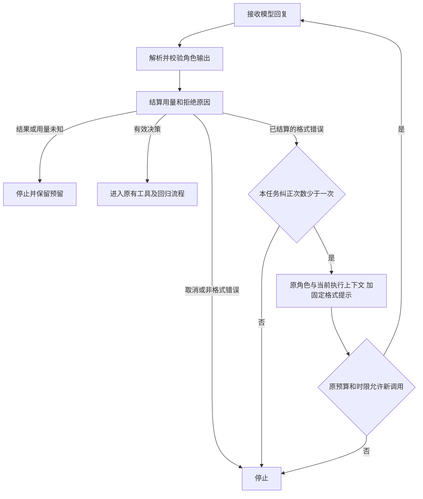

# REL-01 / REL-02：模型回复诊断与一次格式纠正

日期：2026-10-19。Feature P1。用户明确要求本批先实现两项可靠性改进，再继续经验记忆。状态：`planned → ready → in_progress → in_review → done`；实现、测试及独立复审通过。没有修改冻结回归规则、案例、工具权限或任务预算。

## 1. 问题与目标

B5 曾出现一次 `inconclusive / INVALID_MODEL_OUTPUT`。历史代码把严格解析、角色契约与交接拒绝合并，历史原文未保存，无法事后断言具体字段。此次改进让**新运行**可定位拒绝阶段，并对限定的格式失败最多纠正一次；不把历史失败改成成功，也不声称已经找到了历史失败的唯一根因。

保留失败和执行冻结回归原本就是正确行为，不属于本次要修复的缺陷。

## 2. REL-01：持久化拒绝阶段

在模型回复进入工具桥之前，完成 JSON/角色契约及结论交接检查；随后将用量和固定错误代码一起提交到原有模型请求账本。即使后续纠正成功，第一次 `failed` 请求和费用仍在。

| 代码 | 阶段/含义 | 是否允许格式纠正 |
|---|---|---|
| MODEL_RESPONSE_INVALID | HTTP 响应结构无法正确读取 | 否 |
| MODEL_DECISION_INVALID | 工具决策封装不符合要求，例如不是单个 emit_decision | 用量已结算时可以 |
| MODEL_DECISION_JSON_INVALID | 决策 JSON 语法、重复键等不合法 | 用量已结算时可以 |
| MODEL_ROLE_SCHEMA_INVALID | 决策未通过当前角色严格契约 | 用量已结算时可以 |
| MODEL_DECISION_LIMIT | 决策字节数或嵌套深度超限 | 否 |
| MODEL_EVIDENCE_INVALID | 交接结论引用无法核对的证据 | 否 |
| MODEL_EVIDENCE_REQUIRED | 明确需要更多证据，或交接没有支持证据 | 否 |
| MODEL_HANDOFF_INVALID | 当前执行状态不允许交接 | 否 |
| MODEL_OUTPUT_TRUNCATED | 提供方报告输出被截断 | 否 |
| MODEL_TIMEOUT / MODEL_TRANSPORT_ERROR / MODEL_CANCELLED | 传输超时、异常、取消 | 否 |
| MODEL_USAGE_UNKNOWN / MODEL_USAGE_BOUND_VIOLATION | 用量未知或越过预留 | 否；保留预留，停止并核对 |

工具请求中的资源、权限和版本校验继续由原有工具桥负责；其既有错误码不冒称为模型格式失败。原有“工具参数在接收前拒绝”的最多两次纠正与本次机制独立，仍共享原任务总调用、工具、时间和 token 上限。

### 记录与隐私

- 使用既有 `RequestRecord` / `RepairEvent` 保存请求ID、请求摘要、角色、任务修订、固定错误码、已知用量；任务保存模型配置摘要。
- 本批不新增字段或数据库迁移，旧记录的序列化与摘要保持兼容。旧版程序不认识新错误码，因此回滚旧程序前须保留新版数据读取环境，不宣称旧读取器前向兼容。
- **不保存模型原文、Pydantic input/context、字段值，也没有新增模型决策正文摘要。** 与最初“request/decision摘要”的设想相比，本批明确仅采用请求摘要定位，不声称可以还原被拒绝的具体字段。
- 角色契约缺少必需字段与值类型错误归到角色 schema 阶段；“显式 needs_evidence”和“空交接证据”使用专用类型，不能误进格式纠正。
- 网页结果和执行记录显示中文原因；运行记录中的旧错误码仍保留旧解释，不猜测历史原因。

## 3. REL-02：最多一次，不重放

精确条件：当前回复尚未接收或执行任何工具动作、用量已知且合法并已成功结算、账本处于 `ready`、未取消、属于上述三个可纠正代码、任务尚未用过格式纠正。**允许在先前工具已经完成的任务中纠正当前新回复**，不意味着整个任务从未用过工具。

纠正调用使用新的请求ID，经过同一预算预留、持久提交、发送、结算流程，消耗原来的最多12次模型调用和600秒时限；不另送免费额度，不扩大20次工具/2候选/2M token/8192单次输出上限。预算不足则停止，第一次拒绝记录保留。

模型收到宿主固定提示、静态错误码和当前的 completed_reads/execution_progress；不附上上一条不合法输出、错误字段值或隐藏验收规则。已完成的复现/候选/比较状态仍由账本与工具桥控制。

次数是每任务总计一次，不随角色切换重置；Controller 仍是 one-shot，不能恢复并重新发送历史模型请求。原模型请求结算应答丢失时进入核对，不发送纠正；取消、未知副作用、回归失败、证据不足均不能靠该机制重复执行。

纠正本身不代表修复成功。只有实际候选通过原冻结回归才可 `candidate_verified`。目前无独立“纠正成功率”产品指标；通过请求事件及随后调用可审计过程，不以模型重答作为完成证据。

## 4. 实现位置与兼容

| 位置 | 变更 |
|---|---|
| model_gateway/gateway.py | 真实 HTTP 决策封装、JSON、深度/大小分类；用量独立处理 |
| model_gateway/rejections.py | 静态白名单、协议版本2、最多一次策略 |
| orchestration/codec.py / repair_contracts | 可选诊断分类；旧调用保持原错误契约，空交接证据专用类型 |
| repair_runtime/controller.py | 结算前校验、同角色一次纠正、取消/原预算保护 |
| repair_store/store.py | 保留具体错误原因；未知用量仍是 outcome_unknown |
| model_gateway/repair.py / web_repairs/policy.py | 新协议/纠正策略写入配置与网页策略指纹 |
| frontend/lib/repairs.ts、analyses.ts、run-controls.tsx | 新码严格解析、中文原因、预算内纠正说明 |
| pyproject.toml | 启用锁定 mypy 的 TypeForm 支持以匹配 Pydantic 2.14；保留 strict，无忽略规则和依赖升级 |

旧诊断流程已存在的一次格式纠正继续工作；共享 HTTP 解码细分 JSON 错误后，保持原来的可纠正分类。未增加新 Agent、模型、第三方记忆服务或自动代码写回。

## 5. 验收矩阵

| 编号 | 测试 | 通过条件 |
|---|---|---|
| R01 | 真实 HTTP MockTransport 的坏 JSON/重复键/封装/schema | 固定原因持久化，合法用量记录，无原文泄漏 |
| R02 | 单角色/三角色，第一次格式错误后返回有效决策 | 最多一次额外模型调用，通过原工具/冻结比较链 |
| R03 | 已完成读取或 T05 后发生格式错误 | 旧读取上下文保留，复现仅一次，比较仍四槽 |
| R04 | 第二次错误发生在另一角色 | 全任务限额不重置，停止且无新候选 |
| R05 | 模型调用/token额度不足、原截止时间到期 | 不越预算、不另起任务 |
| R06 | 未知用量/超时/截断/字节或深度超限 | 不纠正，未知预留不释放 |
| R07 | needs_evidence、空/伪造引用、不允许交接 | 阶段可定位，不走格式重试 |
| R08 | 结算提交成功但应答丢失、结算后取消 | 没有第二次发送，没有工具执行 |
| R09 | 修复结果的六类新码 | 网页能解析显示，无无效DTO导致整页不可读 |
| R10 | 完整Python及网关/预算/Store旧回归 | 旧记录、权限、持久账本与取消边界保持 |
| R11 | 现有网关+真实Docker+生产网页双案例与停止 | 验证正常闭环无回归；不把未触发的纠正算真实成功 |

确定性故障注入证明具体恢复边界；真实模型验收用于检查当前网关与实际执行链，不能保证自然触发格式错误。两种证据分别报告，所有真实尝试保留。

## 6. 验收记录

### 自动化与页面检查

- 全量 Python：`uv run --frozen pytest -o addopts='--import-mode=importlib' -q`，**1623 passed / 67 skipped / 1 warning，232.00s**。跳过项主要为显式开关的真实集成门禁；warning 为已有 fork 多线程警告。
- 最后新增截止时间反例后单独运行 `tests/agents/test_repair_protocol_recovery.py`：**35 passed，16.49s**。这35项与全量有重叠，不相加冒称独立用例总数。
- `tests/test_b5_live_gate.py`：**24 passed**。验证辅助门禁的隔离、失败保留和清理核对。
- 生产前端 `npm run build`、`npm run typecheck` 通过；`PLAYWRIGHT_CHANNEL=chrome npx playwright test tests/repairs.spec.ts tests/document-reader.spec.ts`：**42 passed，29.2s**，包含六类拒绝原因的严格DTO读取/显示和文档深浅色/窄屏检查。页面故障态使用明确的测试数据，不冒称自然模型输出。
- `uv run --frozen ruff check .`、`ruff format --check .`（426文件）、`uv run --frozen mypy`（139源文件）、`git diff --check` 通过。
- 本地日志：`artifacts/rel-01-02-pytest.log`、`artifacts/rel-01-02-browser.log`。这些运行产物不提交公开仓库。

### 当前网关、真实 Docker 与生产网页

复用 `ops/b5_live_gate.py --execute` 的隔离运行器；每轮独立数据库/构建目录/端口，Playwright无自动retry，每个案例只提交一次。未变更已有模型配置，凭据仅由隔离API进程加载。

| 尝试 | 实际结果 | 门禁结论 |
|---|---|---|
| `03d4c80d-7695-4fd7-9f26-b9c1f68c4f41` | 两个修复案例均 candidate_verified，各5模型/5工具；取消为 MODEL_CANCELLED、outcome_unknown、1模型0工具，预留1056768保留 | **failed 保留**：旧停止断言期待 MODEL_USAGE_UNKNOWN；实际行为正确，测试未适应更准确错误码 |
| `a10bf8c8-56e7-4858-8245-15236c188809` | 更新三处严格错误码断言后完整复验；两个修复案例分别5/7模型、5/7工具；停止仍为1模型0工具、未知预留保留 | **passed，3浏览器测试，45.8s**；真实审批、精确补丁下载、撤回、刷新与取消检查通过 |

每轮报告位于 `artifacts/b5-live/<尝试ID>/report.json`。全部任务无active/pending、容器确认不存在、四个冻结槽完整；子进程清理与构建文件恢复通过。两轮四次正常修复都通过，但仅覆盖两个重复内置案例，不能据此报告泛化成功率。

核对每轮SQLite模型请求，只有取消记录具有error_code，**没有自然触发格式纠正**。因此本批真实运行证明正常执行链无回归；格式恢复有效性与不重放边界由确定性故障注入证明，不能把真实4次通过当成REL-02收益。历史B5无法判定的具体原文原因仍不可还原。

### 独立复审

专职reviewer只读实现并独立运行定向测试，核对真实报告与生产UI日志。初审提出空证据交接、21–30层嵌套、真实HTTP JSON分类和前端枚举兼容问题，均修复并复审。无未解决 Defect P0/P1/P2。真实产物检查和失败保留见评审附录。

独立评审：[REL-01-02-review](reviews/REL-01-02-review.md)。下一项为 P1-02 M1 经验存储，记忆仍未实现。
