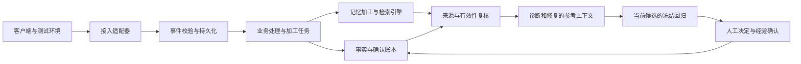

# P1-02：长期记忆业务、外部接入与产品交互

日期：2026-10-19（Asia/Shanghai）。优先级：Feature P1。状态：业务设计 `done`；权威存储、引擎、网页管理、事件接口及经客户端信任的 Codex Hook 已交付，见[46](46-m1-r-authority-event-store.md)、[47](47-m2-r-engine-and-retrieval.md)、[48](48-m4-r-web-memory-hooks.md)；Agent 授权取用见[49](49-m3-r-agent-memory.md)。M5-R 评估进行中，见[50](50-m5-r-memory-evaluation.md)。下文设计范围与历史说明不等于全部效果门槛已完成。

本文件是长期记忆的当前业务与架构边界依据，承接用户本轮确认的业务方向。它取代[42：早期调研与设计](42-p1-02-memory-research-design.md)中“仅限同版本精确召回”“排除 Cognee”“没有异步加工/外部接入”的决策。42 的旧技术规格保留供追溯，不得直接作为本轮数据库及查询实现规格。已通过的旧设计评审仅覆盖当时范围。

本文件只记录本产品需求及公开资料，不收录其他私有项目的代码、路径、命名、截图或实现细节。此次文档交付不授权自动采集外部会话、迁移主库、安装新模型或执行外部仓库。

## 1. 业务定位与价值

### 1.1 用户与工作

面向维护 Python Agent、MCP 工具及工具适配器的开发者和小型 AI 团队。产品负责**故障复现、回归诊断与修复经验复用**，交付形态仍是本地 CLI 与网页。长期记忆服务于这条业务链，不扩展成通用聊天记忆平台、任意代码修复平台或多租户托管服务。

完整业务链：接入授权运行 → 整理故障证据 → 复现与对比 → 生成隔离候选 → 冻结回归 → 人工接受 → 确认修复经验 → 后续任务参考。

| 用户问题 | 产品动作 | 可检查的结果 |
|---|---|---|
| 改工具接口后参数或返回值不兼容 | 比较契约并关联测试 | 字段/类型/必填项差异及实际失败项 |
| 改模型配置、Prompt 或 Skill 后行为退化 | 同用例、同预算比较运行 | 可对齐的步骤差异、无法对齐部分、通过与失败变化 |
| 相似故障反复排查 | 查找经历和经验 | 来源任务、当时环境、无效尝试、适用条件 |
| Agent 声称修复成功但没有依据 | 重新执行当前冻结回归 | 当前候选和验证记录，不采用旧成功自述 |
| 用户纠正后系统仍重复犯错 | 形成有出处的待确认经验 | 修订、确认、使用及撤回记录 |

### 1.2 收益与停止条件

衡量排查耗时、人工补充步骤、重复工具调用、修复通过率及回归率；同时统计提取/embedding/检索/主任务的完整消耗。接入数、记忆条数和图谱节点数仅是运行量，不代表用户收益。

无可复现收益时，不宣传记忆提高修复率。来源不足时说明缺失材料；相似性只能提供线索，不能证明根因。继续遵守[产品约束](01-constraints.md)的真实接入及独立评测门槛。

## 2. 三种记忆与两条信任边界

| 类型 | 内容与来源 | 管理与用途 |
|---|---|---|
| 历史经历 `episode` | 授权运行、失败、尝试、外部测试、环境与版本引用 | 原始事实/外部报告与模型摘要分开；本地可追踪，不能自动晋升可信经验 |
| 修复经验 `repair_experience` | 从经历中整理的排查方向、适用条件、修复方法 | 生成草稿后明确确认；引用源记录，供诊断/修复参考 |
| 项目约束 `project_constraint` | 用户明确确认的接口兼容和允许修改范围等约定 | 保存声明来源和修订；不能覆盖工具权限、预算或冻结标准 |

### 2.1 来源可信程度与发布状态独立

来源标记至少区分 `external_report`（外部执行报告）、`local_user`（用户说明）、`internally_verified`（本产品冻结回归记录），合成资源另标 `synthetic`。这些字段由宿主核验生成，接入方不能自报内部验证成功。外部命令退出 0、用户接受建议、LLM 判定有用均不能变成 internally_verified。

经验状态为 draft / confirmed / revoked / deleted，适用性为单独计算结果。经验草稿可以来自失败、未知经历或用户纠正，但必须保留“失败/未知/用户说明”性质；不得编造确定根因或成功修复。内部已验证修复类草稿还要绑定当前候选决定；接受候选与确认经验是两个动作。

历史经历可以在界面检索。进入模型的参考正文必须符合授权、确认、范围和有效性检查；未确认草稿不自动注入。现有合成资源外发授权不扩展为用户原始 trace、终端输出或源码的外发授权。

### 2.2 可供参考与当前已验证分开

- 同项目、同工具语义、相同版本的有效经验：可标记 `exact_context`，仍不是当前修复的验证结果。
- 同项目中版本不同但有相关公开症状：仅在用户启用该项目的跨版本参考策略后，经过确定性范围过滤，允许返回 `historical_hint`。展示源版本、当前版本、差异与尚未核验的条件；不自动应用旧补丁，不继承旧回归通过状态。
- 未授权项目、撤回/删除/过期、来源不可用、规则冲突、引用无法确认：不得通过语义相似度绕过拒用。跨项目自动复用不在本业务范围内。
- 项目约束不通过近似匹配推断有效性；其作用域由用户确认的宿主对象决定。
- 修改经验立即暂停旧修订使用，重新确认后才恢复；确认和撤回采用版本 CAS 与幂等请求。

例：旧任务证实适配器把某数值字段输出为字符串。新版本出现相似症状时，可以提供旧排查方向和来源；当前根因及修复效果由本次执行判断。

## 3. 组件职责与选型决策

| 组件 | 负责 | 不拥有的权限 |
|---|---|---|
| FastAPI 接入服务/适配器 | 连接身份、事件契约、去重、授权材料引用 | 不根据通知自动执行外部代码 |
| 现有 SQLite + SQLAlchemy + Alembic 权威账本 | 事实、来源、审批/撤回、修订、请求预留、outbox | 不用向量分数改写验证结论 |
| 记忆加工/检索引擎 | 组织经历、候选经验提取、语义与关系召回 | 不直接批准经验、修改权限或发布补丁 |
| 领域接入层 `experience_memory` | 参考资格、失效检查、审计、上下文预算 | 不重造通用图数据库、embedding或Agent框架 |
| 现有 LangGraph 与各角色 | 诊断、修复、验证解释；统一工具与网关 | 验证角色不读取修复经验正文作为通过依据 |
| 网页与 MCP | 管理、查询、解释来源和提交受控操作 | 接口返回成功不等于任务验收成功 |

### 3.1 已确定与待验证的内容

**已经确定**：上述职责划分；权威事实与记忆检索分离；保留现有编排、网关、受控执行和审批账本；采用统一外部事件契约；由领域层复核参考资格。批次只划分开发与验收，不预设“先临时实现，以后替换”。

**当前选型已在MR-01及M2-R冻结并验证：Cognee 1.6.5，现有DeepSeek/bge-m3，独立SQLite/LanceDB/Ladybug。** 下述为当时选择它进入验证的依据，当前实现和供应链补偿见[47](47-m2-r-engine-and-retrieval.md)。撤销早期“因为业务要确定性所以排除 Cognee”的推理。公开上游具有 Agent 记忆、轨迹和会话经验蒸馏等能力，不能只按文档检索框架评估。只研究公开发行版本及官方源码，不把私有扩展当成安装包能力。

实现前的选型验收 MR-01 必须冻结：公开版本/提交和许可证依赖清单；实际采用的 API 与后端配置；现有模型网关的兼容性；embedding 的可用来源、数据外发与费用；自带模型调用能否纳入我们的预算/取消记录；来源/修订能否完整返回；删除后旧索引能否被领域层拒用。新增 embedding 或其他模型不因本文自动获准。

若候选引擎不能满足必要契约，应在开工前给出失败证据并重审选型；不能边实现边无记录替换。权威账本和引擎存储不要求共用数据库事务，不因引擎支持 Postgres 就提前迁移已有账本。投影通过 outbox 同步，读取再次核对权威状态。

### 3.2 一致性与费用不变量

- 确认/撤回/删除与相应 outbox 在同一事务提交；索引失败不回滚人工决定，显示待同步或同步失败。
- 引擎返回的条目必须携带权威 memory_id、revision、内容摘要和来源关联；无法映射则不注入。仅返回一段无出处总结不满足契约。
- 同一 scope 的确定性冲突检查不能只看语义 top-k。检查不完整时拒绝相关注入并报告 limited/unavailable。
- 调用模型前核对当前确认、来源、版本策略与有效期，并将 memory refs 与请求预留绑定；删除先于预留提交则不得发送，已预留的在途内容不可承诺追回。
- 提取与索引任务使用独立作业预算，不挪用或绕过修复任务预算。若引擎无法接入调用记账，不允许自动提取。具体限额在 MR-01 后冻结，缺配置默认禁用。
- 默认不发送原始对话、密钥、完整日志或未授权源码；授权按项目、来源、内容类型与用途记录。查询引擎本身可能有外部调用，也纳入授权和成本。
- 删除清除逻辑正文并安排派生索引清理；墓碑即时阻止召回。备份、源运行记录、下载文件、在途模型请求的删除边界向用户说明。

## 4. 外部接入形式与统一事件

| 来源 | 交付形式 | 行为 |
|---|---|---|
| Codex 等编程客户端 | 项目级插件：Hook 脚本与 MCP 配置 | 事件采集与主动经验查询分开，逐客户端验证能力 |
| 本地测试工具 | CLI 或测试适配器 | 解析结构化报告，上传允许的元数据和材料 |
| CI | 流水线步骤或报告产物 | 发送到配置的可达服务，或让用户本地导入 |
| 外部平台 | Webhook 适配器 | 验证平台签名/重放后规范化事件 |
| 用户的 Agent | Python SDK 或 HTTP API | 显式上报授权工具执行和任务生命周期 |
| 手动接入 | 网页报告导入 | 使用同一校验与归属规则，不建立另一套业务逻辑 |

本地 localhost 不可直接作为云平台回调地址。不为了接入自动开公网、建立隧道或引入多租户。统一服务可先支持本地投递与离线导入；客户端覆盖是实施范围，不承诺所有平台 Hook 同名同义。

建议代码边界：`integrations/<source>/` 处理来源格式；`integration_events/` 管理接收、幂等与投递；`experience_memory/` 管理业务；第三方引擎放独立 provider adapter。产品 Agent 保持各自目录，来源适配器不是新增 Agent。

### 4.1 接收契约（拟定，未实现）

- `POST /api/integrations/{connection_id}/events`：持久接收并返回 event_id/receipt/status。
- `GET /api/integrations/{connection_id}/events/{event_id}`：受连接权限约束的结果查询。
- `GET /api/integrations/{connection_id}/status`：接收、处理、积压和失败信息。
- 大报告使用独立受限 artifact 上传/导入流程，事件只携带授权引用；不把任意路径或 URL 交给后台直接读取。

| 字段 | 约束 |
|---|---|
| schema_version / event_type | 版本化白名单；未知版本拒绝，不静默猜字段 |
| event_id | 来源事件标识；幂等范围为 connection_id + event_id，同键异内容409 |
| source_run_id / parent_run_id / sequence | 支持主/子运行关联；缺失可空但必须标记记录不完整，不伪造顺序 |
| occurred_at / received_at | 来源时间与服务端接收时间分开，不能只按来源时钟排序 |
| revision | 代码/工具/模型配置摘要；未知明确为空，不推测 |
| artifact_refs | 内容摘要、类型、大小及授权引用；hash不等于匿名化 |
| payload | 按业务事件分别校验，限制字段、大小、深度 |

项目归属由服务端连接凭据绑定，payload不能覆盖；凭据可撤销，不出现在浏览器日志/导出记录中。浏览器管理动作遵守本地来源校验，外部写入不能借宽泛 CORS 绕过凭据。

接收事件与处理任务原子入库后返回 accepted；accepted 不表示 processed，更不表示故障已修复。精确重传去重与相似故障聚合分开：后者保留每次独立发生记录，不合并掉证据。

### 4.2 投递与故障处理

处理器采用有租约、重启可恢复的 outbox/job 消费与幂等结果写入，承诺至少一次投递和可去重结果，不承诺外部副作用 exactly-once。乱序事件按来源标识关联，缺口显示不完整；不能因为先收到结束事件就推断所有步骤齐全。

连接停用后拒绝新接收，并暂停尚未获执行授权的加工任务；已接收数据是否保留由独立删除操作控制。发送端缓冲需有容量/保留期，超限可见且不得静默丢失。限流、重试、死信、最长处理时间和文件限制在接入规格冻结，缺少限额不开放连接。

Hook 只做轻量过滤和持久入队，不直接跑模型总结；本机服务故障时使用有界缓冲并显示错误，不能拖住外部开发会话。模型请求结果未知时保留费用和状态，不盲目重发。

## 5. 业务 Hook 目录与优先级

以下为本产品业务事件，非平台原生事件名称。全部处于设计状态。

| 编号 / 优先级 | 触发与输入 | 系统产出 | 用户动作与验收重点 |
|---|---|---|---|
| BH-01 / Feature P1 | 测试完成：报告、版本、失败项 | 故障记录、相似经历、材料缺口 | 准备复现；报告不足不自动执行 |
| BH-02 / Feature P1 | MCP/schema变更：前后契约 | 字段/类型/必填项差异、关联测试 | 选择兼容性检查；缺前版本不编造差异 |
| BH-03 / Feature P1 | 模型/Prompt/Skill变更：配置、冻结案例、轨迹 | 行为对比、回归变化、费用 | 明确预算后运行对照；工具步骤差异不等同根因 |
| BH-04 / Feature P1 | 同类故障再次出现：签名、版本、独立运行 | 聚合次数、受影响版本、历史处理 | 查看证据；重传不重复计数，不同运行不抹掉 |
| BH-05 / Feature P1 | 用户纠正：说明及关联任务 | 带来源的经验草稿 | 编辑/确认；用户说明不升格为内部验证 |
| BH-06 / Feature P1 | 当前回归通过且候选被接受 | 修复经验草稿及证据引用 | 预览/确认；补丁接受不自动发布经验 |
| BH-07 / Feature P1 | 依赖/工具/环境版本变化 | 需要复核的经验、差异条件 | 重新验证/撤回；历史参考与当前有效分开 |
| BH-08 / Feature P2 | 多次经验显示稳定流程 | 带依赖与权限声明的Skill提案 | 独立审查与测试；不得自动发布可执行流程 |

实现顺序优先 BH-01/BH-02/BH-06，BH-03随差异引擎契约验收，不因此增加任意模型选择或全仓修复。其余事件复用相同接入与经验生命周期，不为每种 Hook 新造平台。

### 5.1 Codex 作为明确的外部客户端

计划映射：SessionStart绑定项目和查询入口；PostToolUse采集允许记录的执行结果；Stop增量收尾；SessionEnd补充结束信息。MCP用于主动查询经验/来源和提交受控草稿。Stop不是任务成功，SessionEnd不能作为唯一保存时机；不同事件覆盖情况需本机版本实测。

安装插件不等于 Hook 已获得用户信任，不能自动绕过信任检查；不读取全部聊天历史。若实现采用 additionalContext，必须只放受控入口/有限参考并明确其数据性质，不能把任意检索文本变成规则或权限。结构化MCP查询作为按需返回渠道；Hook与MCP不能重复计算同一次事件。

## 6. 页面与操作设计

2026-10-21 页面归属调整：来源接入是记忆业务子模块，统一位于“记忆 → Hook 与事件”，不再承载在“环境与接入”；后者只负责本机环境、模型及工具配置。见 [UI-09](52-ui-09-memory-navigation.md)。

保留本产品已有视觉语言、浅色/深色/跟随系统、紧凑排版与可访问性。以下是功能信息架构，不复制其他产品的页面、品牌、组件或源码。所有设计入口待真实操作验收后才标记可用。

| 页面 | 核心内容与布局 | 主要操作 | 空态/异常 |
|---|---|---|---|
| 接入 | 连接列表＋详情；项目、事件授权、最近接收/处理、积压 | 配置、测试事件、暂停、撤销、查看失败 | 区分未配置、等待事件、处理失败；配置存在不等于已连接 |
| 运行与故障 | 紧凑列表＋详情；症状标题优先，ID折叠；证据、版本、缺口 | 准备复现、补材料、打开历史、进入修复 | 外部记录不完整时明确缺项，无虚假复现按钮 |
| 诊断与修复 | 当前证据/补丁/回归为主；相关经验侧栏可折叠 | 查看命中理由/来源、标记不适用、打开原任务 | 区分无匹配、服务不可用、已撤回、预算不足 |
| 项目经验 | 项目/工具/类型/状态筛选＋详情抽屉 | 确认、修订、撤回、删除、查看使用记录 | 草稿与已确认分开；修改使旧修订暂停使用 |
| 回归对比 | 前后配置、步骤对应、失败变化与成本 | 查看差异证据、打开案例、明确授权后重放 | 不可对齐、缺基线、未知结果单独展示 |

### 6.1 用户主路径

1. 新建项目连接，选择采集范围，发送测试事件；页面分别显示接收与处理结果。
2. 测试失败进入故障列表，查看材料完整度；取得所需资源授权后准备复现。
3. 诊断/修复读取确认过的经验作为参考，显示原因、版本差异与出处；用户随时查看当前执行证据。
4. 当前候选完成冻结回归，用户决定接受或拒绝；通过且接受后可以生成经验草稿。
5. 用户预览外发内容及适用范围、显式确认；后续任务记录实际选用修订，不以模型自述作为命中证据。
6. 用户纠正、撤回或删除后，界面立即反映权威状态，并显示派生索引清理进度。

### 6.2 次要视图与文案

来源关系图只作为详情的辅助：经验 → 来源故障 → 补丁 → 回归 → 后续使用。优先提供可访问的列表/链接，同一信息不强迫用户通过图操作。没有关系信息时不展示装饰性图谱。

技术ID、原始JSON、安全摘要、版本哈希放在“技术详情”；正文突出故障、来源、可执行动作和未完成条件。抽屉支持键盘、焦点恢复与深链接，移动端用单列详情。动画用于展开/状态变化/导航反馈，遵守减少动态效果偏好。

运行成功率与记忆收益分开，用户页面不显示开发里程碑编号/测试数量，不将合成示例伪装成用户历史。

## 7. 验收矩阵

下表是完整验收要求；已完成项及证据见第8节和46–49交付记录。文档检查通过不等于运行验收通过，M5效果门槛仍未完成。

| 编号 | 场景 | 必须验证 |
|---|---|---|
| BM-01 | 连接伪造/跨项目/撤销凭据 | 拒绝访问及事件写入，不泄露其他scope存在性 |
| BM-02 | 重传、同键异内容、重启 | 一份持久接收结果；异参409；不重复形成草稿 |
| BM-03 | 乱序/缺步骤/客户端突然退出 | 不误报完整运行；增量事件仍可查；无SessionEnd也不丢已接收事件 |
| BM-04 | 报告材料不足/退出0 | 显示缺口；不能直接复现或标内部验证通过 |
| BM-05 | 经验参考分类 | exact_context与historical_hint分开；版本不符不继承验证状态；策略关闭拒绝跨版本参考 |
| BM-06 | 跨项目/未确认/撤回/到期/错误来源 | 引擎即使命中也不注入；未知来源为unavailable而非可信 |
| BM-07 | 索引滞后与并发删除 | 先删除后预留不得发送；已在途边界明确；旧缓存/索引不复活正文 |
| BM-08 | 冲突不在top-k | 仍能由权威范围检查阻止相关注入；检查超限显示limited |
| BM-09 | 错误经验和提示注入 | 权限/预算/冻结回归不变；验证角色不采用经验为证据 |
| BM-10 | 模型提取/检索失败或未知用量 | 原任务结果不改写；作业失败可见、预算保留、无无限重试 |
| BM-11 | 接入/UI完整流程 | 配置→测试→故障→补材料→复现→修复→确认经验→召回→撤回→不再使用 |
| BM-12 | 多主题/390px/键盘 | 无整页溢出、抽屉焦点恢复、图有文本替代、状态可辨认 |
| BM-13 | 实际第三方引擎 | 锁定公开版本真实运行；来源可追溯，删除复核和调用成本实际可测 |
| BM-14 | 同条件对照 | 相同模型/用例/预算、正确/错误/无记忆全尝试保留；提取成本单列后计入总成本 |
| BM-15 | 外发与日志 | 未授权正文和密钥零外发；数据用途撤回使后续加工停止；hash不当匿名化 |
| BM-16 | 平台Hook真实覆盖 | 对指定客户端版本检查事件/子任务/中断/恢复，不用模拟事件冒充真实接入 |

保留42中的CAS/幂等/取消/迁移/删除测试意图；其中M03/M04“版本不同零返回”调整为BM-05的分级规则，M11–M14按新引擎费用及取用契约重写。原18次同fixture实验只能验证局部链路，不能证明跨版本参考收益；增加有来源标注的相关/不相关跨版本案例与独立工具项目，冻结集合后报告分组结果，不混入训练或经验提取源。

## 8. 实施门禁与当前下一步

| 工作包 | 优先级 / 当前状态 | 交付门槛 |
|---|---|---|
| M0-B 业务与交互规格（本文） | Feature P1 / done | 业务职责、事件、页面、信任边界和测试独立评审通过；仅文档交付 |
| MR-01 记忆引擎与契约验证 | Feature P1 / done | [45锁定选型与实测](45-mr-01-cognee-contract-validation.md)；实验有条件通过，依赖安全残余保留，生产运行未开放 |
| M1-R 权威领域与事件存储 | Feature P1 / done | [46交付](46-m1-r-authority-event-store.md)；权威领域、事件去重、outbox/租约、请求账本与0011迁移完成，独立评审通过 |
| M2-R 检索、有效性复核与记账 | Feature P1 / done | [47实施与验收](47-m2-r-engine-and-retrieval.md)：Cognee适配、来源映射、参考分级、冲突、实际HTTP预算与回收 |
| M3-R Agent与内部业务事件 | Feature P1 / done | [49实施与验收](49-m3-r-agent-memory.md)：逐请求授权、角色隔离、BH-06草稿、真实模型及生产网页闭环已通过；M5另验收益 |
| M4-R 外部接入与产品页面 | Feature P1 / done | [48交付记录](48-m4-r-web-memory-hooks.md)：网页管理、事件接入与已信任Codex Hook实际触发；CI/真实工具接入与P1-03协调 |
| M5-R 综合效果验收 | Feature P1 / in_progress | 真实模型/容器/外部事件、有无记忆对照、独立复审、前端与常驻同步 |

原M1 ready是旧需求下的历史状态；旧工作包被本表取代，当前M1-R至M4-R已按各自交付文档验收。P1-02父任务保持in_progress，下一项为M5-R综合效果验收。REL-01/02属于模型回复恢复，REL-03的embedding请求恢复另有独立规格；不得混淆两者的重试边界。

## 9. 公开依据与决策记录

- [Cognee官方文档](https://docs.cognee.ai/)；[公开improve源码](https://github.com/topoteretes/cognee/blob/main/cognee/api/v1/improve/improve.py)；[公开经验蒸馏源码](https://github.com/topoteretes/cognee/blob/main/cognee/modules/session_distillation/distill.py)：公开能力依据，main会变化，MR-01必须锁版本，不据宣传指标保证效果。
- [Codex Hooks](https://learn.chatgpt.com/docs/hooks)与[插件打包](https://developers.openai.com/plugins/build/plugins)：事件与信任机制依据；本地实际支持以接入验收为准，聊天存档格式不作为稳定采集协议。
- [42早期设计](42-p1-02-memory-research-design.md)、[43协议恢复交付](43-rel-01-02-model-recovery.md)：历史设计及现有执行链依据。

ADR-M07：确定性验证与经验召回分别设计；来源和确认权威不交给模型。ADR-M08：支持同项目的受控跨版本历史线索，不继承历史验证结论。ADR-M09：统一外部事件与轻量适配器，重用后端业务处理。ADR-M10：Cognee重新进入引擎验证，未完成MR-01前不假称选型验收通过。ADR-M11：UI以可操作故障、证据、经验管理为核心，关系图为辅助视图。

## 10. 本轮文档交付记录

M0-B按planned → ready → in_progress → in_review → done完成；当时MR-01为planned；当前进度见下方与45。独立评审见[记忆业务设计评审](reviews/P1-02-memory-business-review.md)，结论只适用于本文档，不代表运行时可上线。

- 生产构建：`cd frontend && npm run build`，通过；日志 `artifacts/memory-business-build.log`。
- 站内阅读：`cd frontend && PLAYWRIGHT_CHANNEL=chrome npx playwright test tests/document-reader.spec.ts`，7项通过（14.3秒），覆盖本页与历史页、1440/390px、浅色/深色、图表实际渲染、键盘与axe；日志 `artifacts/memory-business-browser.log`。
- 本地交叉引用与 `git diff --check` 通过。常驻前后端已更新；本轮无模型调用、数据迁移或运行功能实现，未以旧Python测试成绩充当本次验收。

### MR-01后续记录

已完成隔离引擎实验，选型与契约见[45](45-mr-01-cognee-contract-validation.md)，已独立评审并以选型实验done结束（Conditional Pass；保留安全残余）。采用Cognee与既有DeepSeek、授权bge-m3；生产记忆、外部Hook和经验页面均未实现。3.1记录的是选型前状态，当前决定与残余风险以45为准。

### ADR-M12：先接通管理与事件入口

2026-10-19 用户明确调整顺序：M2-R → M4-R（网页管理、外部事件与 Hook）→ M3-R（Agent 取用与内部业务事件）→ M5-R（效果评估）。M4-R先提供真实权限、审核与事件状态，M3-R再消费经确认且授权的经验。当前范围的测试、独立评审、前端与常驻服务更新完成后统一推送。当前实施细则见[48](48-m4-r-web-memory-hooks.md)。

### 2026-10-21：请求恢复契约补充

[REL-03](53-rel-03-memory-provider-recovery.md)补充分词资源的离线部署与 embedding 同请求有限恢复。具有有效恢复向量的失败调用可以保留 `unknown` 账单，同时允许结果取用；原有预算上界、授权、角色隔离、未知写操作禁重放不变。M5 成本可比性仍要求完整账单，不把功能恢复当成收益证据。
