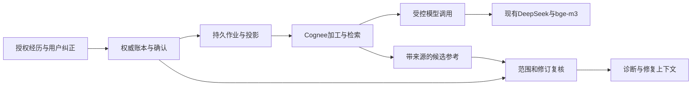

# MR-01：Cognee 选型与契约验证

日期：2026-10-19（Asia/Shanghai）。Feature P1。状态：`done`（选型实验有条件通过，生产功能未开放）。本文件承接[长期记忆业务与接入设计](44-p1-02-memory-product-and-integration.md)。验收对象是**引擎选型和隔离契约实验**，不是产品记忆功能上线。

## 1. 决策摘要

**采用 Cognee 1.6.5 作为记忆加工与检索引擎；复用现有 DeepSeek 和用户明确授权的 bge-m3 服务。**业务权威、权限和费用控制由本产品承担。技术组合固定如下，后续批次划分是实现与验收顺序，不是临时替代技术方案。

| 责任 | 确定方案 | 依据与边界 |
|---|---|---|
| 经验确认、修订、撤回、来源授权 | 现有 SQLite + SQLAlchemy + Alembic | 继续使用权威账本；新增表在 M1-R 设计和迁移，不与引擎数据库混用 |
| 记忆加工与召回 | Cognee 1.6.5 独立 provider adapter | 已完成合成材料的实际 SDK 链路；不授予引擎批准经验的权限 |
| 结构化提取 | 现有 `deepseek-v4-1-flash`，`custom` + `litellm_native` | 使用已有兼容网关，不新增文本模型 |
| 向量化 | 已授权的 `bge-m3`，1024 维，`openai_compatible` | 两条输入均返回有限数值向量，实际 Cognee 加工/查询兼容；不下载模型权重 |
| 引擎内部元数据 / 向量 / 图 | 独立 SQLite / LanceDB / Ladybug | Cognee 图后端配置键仍为 `kuzu`；锁定实际 `ladybug==0.19.0`，不是另起 Kuzu 服务 |
| 缓存 | **显式** `CACHE_BACKEND=sqlite` | 禁止文件缓存及失败后自动回退；依赖安全残余见第7节 |
| 作业执行 | 单个引擎写入 worker，业务 outbox 驱动 | 本地单用户部署；产品多个 Agent 不直接并发写图数据库；不宣称多租户或高可用 |
| 对外模型请求 | 宿主受控调用适配层 | Cognee 只获得本机作业令牌；LLM/embedding 都需独立预留、限额、未知结果记录 |

**选型有条件可实施，自动加工仍关闭。**后续必须完成 M1-R/M2-R 的持久账本、并发复核、预算与清理契约；本实验不能作为这些功能已实现的证据。价格未配置，金额为 unknown，不能显示免费或 0 元。



## 2. 可重复的版本和依赖

- 上游 [Cognee 1.6.5](https://pypi.org/project/cognee/1.6.5/)，公开提交 [`37f788bd287750e10d7610173e5332b3843f6ebd`](https://github.com/topoteretes/cognee/tree/37f788bd287750e10d7610173e5332b3843f6ebd)，主项目许可证 Apache-2.0。
- 实验 Python 3.12；独立 `experiments/mr01/pyproject.toml`、`uv.lock` 和带哈希 `requirements.txt`；没有把 Cognee 安装进主项目环境，也未修改主项目锁文件。
- 锁文件含180个包记录（含平台分支）；当前环境实际173个发行包，版本与锁文件、依赖清单逐项一致。关键包：LiteLLM 1.106.0、OpenAI SDK 2.54.0、LanceDB 0.39.0、pylance 12.0.0、Ladybug 0.19.0、SQLAlchemy 2.0.55。
- `experiments/mr01/dependency-manifest.json` 记录实际版本与许可证元数据。`py_rust_stemmers` 的缺失元数据通过安装包 LICENSE 补证 MIT。该清单不是完整法律审计。
- 下载的127份上游 Python 源码与安装包对应文件字节相同；这是所检查文件的比对，不是全包哈希验真结论。包下载曾超时，保留失败日志；后经镜像安装成功。
- 本地证据：`artifacts/mr01/source-wheel-comparison.json`、安装日志、依赖审计文件。`artifacts/` 不提交；可提交的安全摘要在 `experiments/mr01/evidence-summary.json`。

## 3. 实际 API 与数据流

### 3.1 写入与加工

使用 `cognee.add(text, dataset_name=...)`、`datasets.list_datasets()`、`datasets.list_data(dataset_id)` 取得引擎来源标识，再调用 `cognee.cognify(datasets=[...], raise_on_error=True)`。

生产映射必须保存 `project_id / memory_id / revision / content_digest / dataset_id / data_id / source_refs / projection_generation`。内容修订产生新的投影代际；不得只凭名称或向量相似度推断身份。本次只用一个合成来源证明 dataset/data 可映射，完整修订和多来源冲突门禁由 M1-R/M2-R 实现。

### 3.2 检索与引用

选定调用：

```python
await cognee.search(
    query_type=SearchType.RAG_COMPLETION,
    query_text=authorized_query,
    datasets=[authorized_dataset],
    only_context=True,
    verbose=True,
    include_references=True,
    top_k=3,
)
```

实际返回列表中的 `evidence` 包含 segment 的 `artifact_id / dataset_id / data_id / source_ref_key`。当前 `CHUNKS` 路径未实现对应 evidence getter，即使传引用参数也可能为空，因此不作为本产品带来源召回入口。以上依据固定版本的检索器源码和实际运行，不从 API 名称推断能力。

返回内容只作为候选：逐项映射到权威修订，复核项目、确认状态、授权、来源、摘要、有效期和版本策略。缺字段或不可映射拒用；图谱关系不自动变成事实。只取上下文可减少答案生成，但查询仍可能调用 embedding 或其他引擎处理，必须计入预算，不能承诺免费。

### 3.3 删除

先提交权威墓碑及 outbox，再异步清理引擎。本次实验把同一份缓存引用重新送入实验 SQLite 复核：删除前1条可映射，墓碑后0条；`datasets.empty_dataset(dataset_id)` 后数据集列表不再包含该数据集。

这证明**权威拒用可独立于索引清理生效**。没有证明全部图节点、共享边、向量、备份及历史日志都物理清除；也没有测试并发删除和模型预留之间的竞态。生产的来源粒度删除、清理中断恢复、共享来源不误删和代际隔离属于 M2-R 的必测项。

### 3.4 不自动启用的上游能力

会话蒸馏、`improve`、经验图谱、反馈及更复杂检索可以由同一引擎承载，但不能跳过本产品的授权和确认。候选经验形成 draft；接受补丁与确认经验是独立动作。没有本轮实测的能力不标成已交付，也不把引擎反馈直接升级为系统规则。

## 4. 模型、预算和取消契约

### 4.1 已实测的兼容性

独立 provider 探针通过：DeepSeek 返回可解析的结构化 JSON；bge-m3 两条输入返回1024维有限向量。embedding 响应没有每项 `index`，只有 `usage.total_tokens`；Cognee 此适配器按数组顺序取 embedding，实际 SDK 链路可用。最初探针因假定 index 必有而报错，已修正为真实协议检查，不归为远端模型失败。

生产适配器仍须校验返回数量、维数、有限值、输入批次和服务配置版本，禁止混用不同 embedding 的索引；换模型或维数必须重建明确代际，不能悄悄追加到旧向量空间。

### 4.2 为什么不能直接采用 Cognee 的费用汇总

固定源码显示 LLM session usage 为成功后的 best-effort 记录，异常统计可能缺失；LLM、结构化输出和 embedding 的内部重试分布在多个层级。部分重试时间/次数是最低重试条件，不能当成本产品的最大值。一次 `cognify` 不等于一次 LLM 请求。

因此锁定如下生产契约：每次实际 HTTP 请求先经宿主持久预算预留，分别记录 LLM 和 embedding；返回有可信 usage 再结算；断连、超时、取消或缺 usage 为 unknown，保留预留且停止该作业继续外发。内部已付费格式失败也计数，不因 SDK 重试丢账。金额计算需要显式价格版本；缺价格只展示 token/调用数与金额未知。

### 4.3 实验限额与证明边界

| 项目 | 本实验配置 | 尚未证明 |
|---|---|---|
| 实际外发上限 | LLM 6次、embedding 40次 | 生产跨进程持久预留/CAS/崩溃一致性 |
| 载荷/响应 | 请求64KiB；响应流读取最多1MiB | 全部服务端恶意输入防御 |
| 输出/embedding批次 | LLM输出4096 tokens；embedding最多16条、每条4096字符 | 准确输入token上界、网关自身的强制上限 |
| 时间 | 作业180秒；单请求绝对30秒 | 远端计算已被撤销或费用可追回 |
| 停止 | 拒绝新请求，回收实验独立进程组；在途最迟受请求期限限制 | 产品取消状态机与重启后的资源回收 |
| 凭据与日志 | 真实凭据仅宿主父进程；子进程用随机本机令牌；日志仅数值usage/状态 | OS级网络隔离与不可信代码沙箱 |

本实验是受信本地 SDK，不允许执行用户任意代码；关闭遥测、原始文件日志，设置离线模型选项，不以这些环境变量宣称网络硬隔离。无模型权重下载。最新成功运行之后增加显式 SQLite 缓存配置，仅使用安装包配置检查验收，没有再消耗模型调用。

## 5. 实际运行记录与纠错

只上传宿主审核的“count工具返回字符串而非整数”合成短文。它不能证明真实历史经验提高了修复率。

| 顺序 / 产物目录前缀 | 结果 | LLM / embedding实际调用 | 解释 |
|---|---|---|---|
| 1 / `535fe970` | 来源门禁无效，不计通过 | 2 / 5 | SDK流程完成，但引用为空；旧脚本错误地允许 completed |
| 2 / `a0474509` | 来源门禁无效，不计通过 | 2 / 5 | 修正引用解析后 CHUNKS 仍为空；0→0不构成删除拒用证据 |
| 3 / `41fe701e` | 失败，6次unknown | 6 / 0 | 实验 AsyncClient 默认5秒读超时先于30秒外层期限；旧逻辑重复外发到次数上限 |
| 4 / `60568898` | 合成契约通过 | 2 / 9 | 改正确检索路径、非空断言、明确请求期限并在首次unknown后停发；映射1→0，数据集删除 |

第4次 usage：LLM 4,494 total tokens（输入2,027、输出2,467），embedding 1,280 total tokens，共5,774。金额未知。第3次0个已报告token不等于0消耗；六次unknown完整保留，不以最后成功覆盖失败。本次也不将多次调试汇总成模型成功率。

初始两次 SDK 默认产生原始文件日志。发现后记录本次生成文件的哈希/大小，删除这些实验原始日志，保留安全结构化失败证据；后续强制 `COGNEE_LOG_FILE=false`。最新目录 `.log` 数量为0。删除记录位于 `artifacts/mr01/log-cleanup.json`，没有复制原始内容进公开文档。

## 6. 验收与实现门禁

| 检查 | MR-01结果 | 后续必需工作 |
|---|---|---|
| 固定版本、实际依赖、来源源码、许可证清单 | 已核对；保留第7节安全残余 | 升级必须重新锁定、审计、跑契约 |
| DeepSeek + bge-m3兼容 | provider与实际Cognee链路通过 | 接入生产调用网关和授权账本 |
| 来源可映射与删除后拒用 | 单来源实验通过 | 修订/摘要/项目隔离/多来源及CAS测试 |
| 请求级计数与停止边界 | 13项确定性实验测试通过 | 持久预算、重启/并发/未知费用门禁 |
| 显式SQLite缓存配置 | 1项安装包配置测试通过 | 缓存失败拒启、目录所有权和禁止fs的产品测试 |
| 真实产品收益 | 未测 | 冻结有/无记忆对照；不能以合成链路代替 |
| 自动Hook/经验页面/生产索引 | 未实现 | 按44后续批次实施与验收 |

验证命令（仓库根目录）：

```bash
MR01_INSTALLED_CONTRACTS=1 uv run --frozen pytest experiments/mr01/test_probe.py experiments/mr01/test_installed_contracts.py -o addopts='--import-mode=importlib' -q
uv run --frozen ruff check experiments/mr01
uv run --frozen ruff format --check experiments/mr01
```

首次结果14 passed；网络路径测试使用 MockTransport，只证明实验网关的本地处理，不冒充远端取消。模型实验重跑、依赖安装和私有配置见 `experiments/mr01/README.md`，必须显式 `--execute`；普通测试不消耗模型。

### 6.1 M1-R / M2-R的开工与上线区别

MR-01结束后下一项是 **M1-R 权威领域与事件存储**：先冻结schema、作用域、限额、授权与迁移，再实现确认/修订/撤回、投影映射、outbox和请求账本，附CAS/重传/恢复测试。不得直接把实验SQLite或JSON记录复制成生产账本。

M2-R把Cognee worker接入这些账本，验证实际请求预算、完整来源有效性、并发撤回与模型预留顺序、清理作业恢复。未过M2-R门禁前不开放自动提取、外部Hook采集或向修复Agent注入记忆；未授权材料不得外发。本轮不迁移主库。

## 7. 依赖安全残余 MR01-SC-01

**Defect P2，负责人：记忆引擎接入实现者；复核：独立代码评审者。截止门禁：M2-R自动加工开放之前。**

本轮 `pip-audit` 返回非零，diskcache 5.6.3 对应一个唯一公告（输出存在重复项）：[PYSEC-2026-2447](https://github.com/pypa/advisory-database/blob/main/vulns/diskcache/PYSEC-2026-2447.yaml)，别名 CVE-2025-69872 / GHSA-w8v5-vhqr-4h9v。缓存目录可被攻击者写入时，不安全pickle可能导致代码执行；扫描未列出修复版本。

当前补偿控制：新建私有0700实验根目录、不导入不可信缓存、显式 SQLite backend；固定版源码在显式选择SQLite且配置无效时抛错，不回退 filesystem。安装包配置实测确认 `cache_backend` 被记录为显式设置。**diskcache仍安装且可能被模块import；不宣称已移除、不受影响或漏洞清零。**

解除条件：锁定修复依赖并完成回归；或在产品接入中验证禁止fs及回退、目录所有权/权限/符号链接校验、缓存失败关闭服务等补偿控制，由独立评审明确接受残余风险。若目录不受信或后端无法强制，禁止引擎启动。此项不阻断本地隔离选型实验，但必须保留在后续发布门禁，不能用审计忽略规则隐藏。

## 8. 交付状态

MR-01按 planned → ready → in_progress → in_review → done 完成。独立[MR-01评审](reviews/MR-01-cognee-review.md)结论为 Conditional Pass：初审三项Defect P1已修复并复审关闭；残余供应链Defect P2继续跟踪。仅允许按锁定选型进入M1-R，不是生产功能上线验收。

前端只增加本站工程文档入口；长期记忆与外部接入继续标记待开发，不增加虚假的运行按钮或用户历史。验收记录如下。本轮不提交或推送代码。

- 14项实验测试通过（0.31秒）；独立评审者另跑14项通过。
- 全仓库 `uv run --frozen ruff check .` 与 `ruff format --check .` 通过（435个Python文件），`git diff --check` 通过。
- 前端 `npm run typecheck`、`npm run build` 通过；构建日志 `artifacts/mr01/frontend-build.log`。
- `cd frontend && PLAYWRIGHT_CHANNEL=chrome npx playwright test tests/document-reader.spec.ts`：7项通过（16.7秒）；覆盖本页和历史页，1440/390px、深浅色、图表渲染与axe检查；日志 `artifacts/mr01/frontend-browser.log`。
- launchd前后端已更新，两进程PPID为1；API健康、本文档及修复页均HTTP 200。更新后的工程文档不依赖当前对话保持运行。
